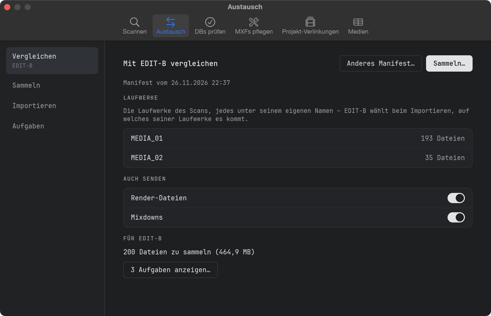
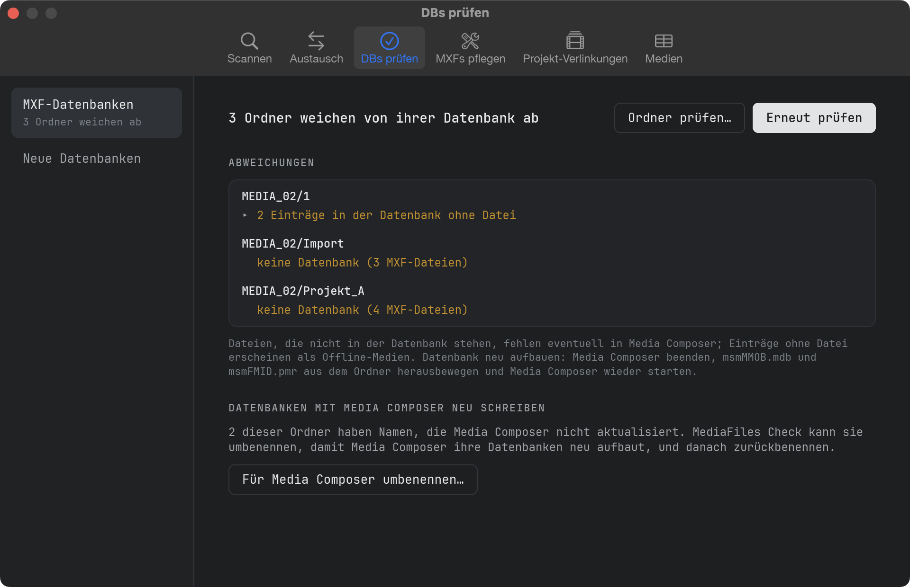
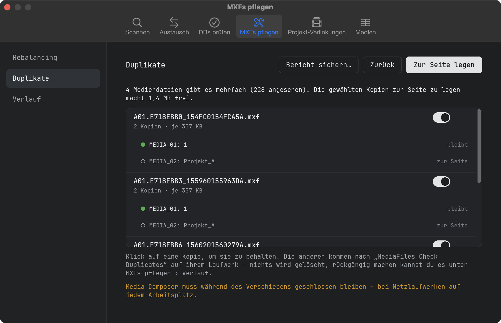
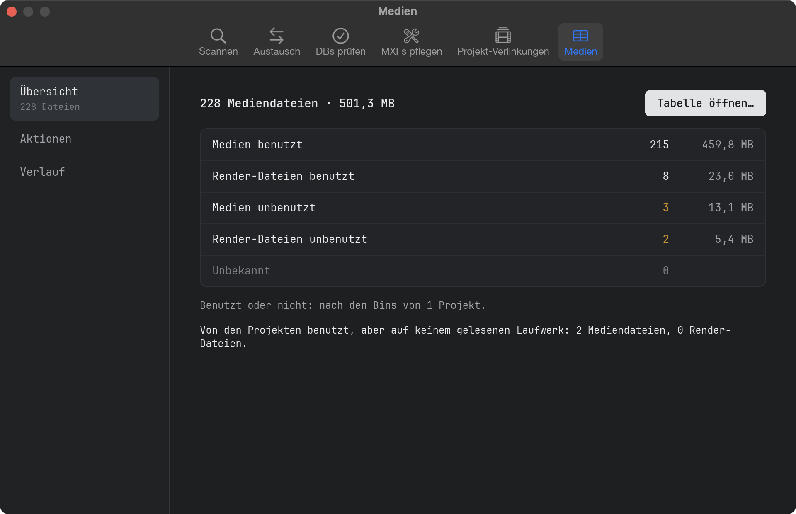

# Anleitung

## Was MediaFiles Check macht

MediaFiles Check kümmert sich um die Avid-Mediendateien (MXF) deiner Schnittplätze:

- **Scannen** liest die Laufwerke und Avid-Projekte einmal; alle anderen Reiter arbeiten mit diesem Scan.
- **Austausch** gleicht die Medien zweier Schnittplätze ab, auch wenn sie nicht verbunden sind.
- **DBs prüfen** vergleicht jeden Ordner in `Avid MediaFiles/MXF` mit seiner Avid-Datenbank, zeigt, wo beide nicht zusammenpassen, und lässt Media Composer neue Datenbanken schreiben (Für Media Composer umbenennen).
- **MXFs pflegen** enthält die Werkzeuge, die Dateien verschieben: Rebalancing, Duplikate und ihr Verlauf.
- **Projekt-Verlinkungen** findet die Mediendateien, die die Bins deiner Avid-Projekte brauchen, die aber auf keinem Laufwerk liegen, und fordert sie an.
- **Medien** listet jede Mediendatei mit Clip, Codec und Größe, trennt Render-Dateien ab und legt unbenutzte Dateien beiseite.

MediaFiles Check **löscht nie** eine Mediendatei und **überschreibt nie** eine. Prüfen liest nur.

## Das Fenster

Die Reiter oben sind die Bereiche. In jedem Reiter stehen links in der Seitenleiste seine Schritte in der Reihenfolge, in der man sie macht; unter jedem Schritt steht kurz sein Stand. Ein kleiner oranger Punkt auf einem Reiter heißt: Dort wartet etwas. Fehler erscheinen als Meldung unten im Fenster; **×** schließt sie. Dort erscheint auch eine neue Version als Karte.

Jeder Scan (Scannen, DBs prüfen, Rebalancing, Duplikate) zeigt unter seinem Balken die Restzeit und zwei Knöpfe: **Pause** hält das Lesen an, bis du **Fortsetzen** klickst; **Abbrechen** beendet den Scan sofort und geht zurück – von ihm bleibt nichts (schon gelesene Prüfsummen und Dateiköpfe werden für den nächsten Scan gemerkt).

Wurde macOS gesagt, dass MediaFiles Check ein Laufwerk nicht lesen darf, bricht ein Scan mit „macOS lässt MediaFiles Check nicht lesen: …“ ab. **Zugriff erneut anfragen** lässt macOS noch einmal fragen – dann Erlauben klicken. Bleibt es gesperrt, öffnen sich die Systemeinstellungen bei Datenschutz & Sicherheit › Dateien & Ordner: Dort die Laufwerke einschalten.

## Was erwartet wird

Auf jedem Laufwerk, auch auf Netzlaufwerken:

- `Avid MediaFiles/MXF/<Ordner>/` mit den `.mxf`-Mediendateien
- die beiden Avid-Datenbankdateien `msmFMID.pmr` und `msmMMOB.mdb` in jedem Ordner
- `Creating`-Ordner und versteckte Dateien werden ignoriert

Die Ordner dürfen beliebig heißen, z. B. `1`, `Avid8.1` oder `Mac Studio.1`. Jedes angeschlossene Laufwerk mit `Avid MediaFiles/MXF` hat einen Schalter; dieselben Schalter gelten für alle Reiter und werden gemerkt. Neue Laufwerke sind eingeschaltet.

## Scannen

Der Reiter **Scannen** kommt zuerst: Sein Scan ist die Grundlage für die anderen Reiter.

1. Scannen › **Scannen**: die angeschlossenen Laufwerke und die Avid-Media-Composer-Projekte einschalten, deren Bins zählen (**Projekte Ordner…** wählt den Ordner, in dem sie liegen), dann **Volumes & Projekt scannen**. Der erste Durchlauf liest den Kopf jeder Mediendatei und jeden Bin, spätere nur neue oder geänderte Dateien und Bins (ein Bin, den Media Composer seitdem gesichert hat). Nach ein paar Sekunden steht rechts unter dem Balken die Restzeit. Danach zeigt die Seite, welcher Scan aktuell ist.
2. Scannen › **Verlauf**: die neuesten 20 Scans. **Laden…** prüft zuerst, ob seine Volumes und Projekte erreichbar sind – sonst steht da, was angeschlossen werden muss. Dann wird der Scan ohne neuen Durchlauf wieder aktuell: zurück auf der Seite Scannen sind seine Volumes und Projekte eingeschaltet, und bei den Volumes steht, wann sie gescannt wurden. **×** entfernt einen Scan (mit Rückfrage); **Alle löschen…** fragt vorher nach.

Der Scan schreibt auch das *Manifest* für Austausch: jede MXF-Datei der eingeschalteten Laufwerke mit Prüfsumme – eine Dateiliste, keine Medien. Der erste Scan liest dafür jede Datei einmal und dauert länger; spätere lesen nur neue oder geänderte Dateien. Ein aus dem Verlauf geladener Scan macht sein Manifest wieder aktuell (vor dieser Version gesicherte Scans haben keins).

## Austausch: Vergleichen und Sammeln

Austausch › **Vergleichen** → **Manifest sichern…** speichert das Manifest des letzten Scans z. B. als `261101-1312_Mac Studio_Manifest.mfexchange`. Schick es an den anderen Schnittplatz, z. B. per Mail oder USB-Stick. Ohne Scan steht dort **Noch kein Scan** – **Zu Scannen**.

1. Zuerst diesen Schnittplatz unter Scannen scannen, damit das eigene Manifest aktuell ist.
2. Austausch › **Vergleichen** → **Manifest öffnen…** und das Manifest des anderen Schnittplatzes wählen – oder eine Anforderung aus Projekt-Verlinkungen › Anfordern.
3. **Laufwerke und was mitgeht:** Die Seite listet die Laufwerke des Scans – jedes geht unter seinem eigenen Namen, die andere Workstation wählt beim Importieren, auf welches ihrer Laufwerke es kommt. Welche Laufwerke mitgehen, entscheidest du beim Scannen. Unter **Auch senden** **Render-Dateien** oder **Mixdowns** ausschalten, um sie wegzulassen (erkannt am MXF-Header; ein Ordner, dem sie dann fehlen, bekommt statt seiner Datenbank die Aufgabe „Datenbank neu schreiben“). Die Wahl wird gemerkt. Bei einem älteren Scan bittet die Seite, erst neu zu scannen.
4. Anzahl der Dateien prüfen – **… Aufgaben anzeigen…** öffnet die Aufgaben in einem eigenen Fenster –, dann **Sammeln…** und wählen, wo der Lieferordner entstehen soll.

Jede Datei wird mit Prüfsumme in einen neuen Ordner wie `261102-1830_Mac Studio_to_MacBook` kopiert, zusammen mit `Aufgaben.txt` (Anleitung zum Importieren von Hand). Nochmal Sammeln nach einer Unterbrechung macht dort weiter, wo es aufgehört hat. **Zu wenig Platz:** Passt die Lieferung nicht (auf jedem Laufwerk bleibt 1 GB frei), fragt MediaFiles Check nach einem weiteren Ort – auf einem anderen Laufwerk – und teilt die Lieferung in Teile (`…_part1of2`, `…_part2of2`); ein Ordner bleibt nach Möglichkeit zusammen.

## Austausch: Importieren

1. Media Composer beenden.
2. Austausch › **Importieren** → **Lieferung wählen…**. Eine Lieferung, die für ein anderes System gesammelt wurde, wird abgelehnt – spiel sie dort ein. Eine Lieferung in Teilen: alle ihre Ordner im Dialog gemeinsam auswählen – fehlt ein Teil, wird nichts eingespielt.
3. Jedes Laufwerk der Lieferung braucht ein Laufwerk auf diesem Schnittplatz; gleichnamige werden automatisch zugeordnet. Mit **Trennen** gehen die Mediendateien auf ein Laufwerk und die Render-Dateien auf ein anderes (erkannt am MXF-Header).
4. **Ordner:** Die Seite zeigt, wie viele Ordner zusammengeführt werden; **Ordner festlegen…** öffnet ein Fenster mit allen Ordnern der Lieferung: für jeden Ordner **Zusammenführen** (in den Ordner mit demselben Namen) oder **Eigener Ordner** (`<Absender>_<Ordner>`, z. B. `Mac Studio_1`; gibt es ihn schon, kommen die Dateien hinein). **Alle zusammenführen** / **Alle in eigene Ordner** wählt für alle.
5. **Prüfen & importieren** prüft zuerst jede Datei. Nur eine vollständige, unbeschädigte Lieferung wird importiert – Dateien kommen nur dazu, eine Mediendatei wird nie überschrieben. Ersetzte Datenbanken bleiben in `Avid MediaFiles/Exchange-Backup/`.
6. Danach unter Scannen noch einmal scannen, damit das Manifest aktuell ist.

## Austausch: Aufgaben

Austausch › **Aufgaben** listet die Aufgaben der Lieferungen, die hier gesammelt oder importiert wurden – z. B. „Datenbank neu schreiben“ oder „Gleicher Name, anderer Inhalt“. Es stehen nur Aufgaben für diese Workstation da; Aufgaben für die andere Workstation gehen mit der Lieferung mit (`Aufgaben.txt`, dort auch die Anleitung zum Importieren von Hand). **Prüfen…** prüft einen Ordner dieses Schnittplatzes, der eine neue Datenbank braucht; **Fertig** schiebt eine Aufgabe nach unten zu Erledigt, **Wieder öffnen** holt sie zurück, **Erledigte entfernen** räumt auf. Datenbanken, die nach Rebalancing oder Duplikaten noch neu geschrieben werden müssen, stehen im Verlauf von MXFs pflegen; Ordner, die aufs Zurückbenennen warten, unter DBs prüfen › Neue Datenbanken. Nach dem Sammeln oder Importieren öffnet **Aufgaben zeigen** auf der Ergebnisseite diese Liste, wenn es Aufgaben für diesen Schnittplatz gibt.

## Wann wird etwas kopiert?

Eine Datei gilt als **vorhanden**, wenn sie irgendwo auf dem anderen Schnittplatz mit gleichem Namen und gleicher Prüfsumme liegt.

- **Ordner auf beiden Seiten gleich:** nichts passiert.
- **Ordner fehlt auf der anderen Seite:** der ganze Ordner wird kopiert, samt Datenbank.
- **Eine Seite hat zusätzliche Dateien:** die Dateien und die Datenbank der volleren Seite werden kopiert.
- **Beide Seiten haben eigene Dateien:** nur die Dateien werden kopiert – Aufgabe „Datenbank neu bauen“.
- **Gleicher Dateiname, anderer Inhalt:** nicht kopiert – eine Aufgabe bittet um Prüfung.

Eine Datenbank wird nur geliefert, wenn der Zielordner danach genau wie der Quellordner aussieht; eine Datenbank wird nie gelöscht. Beim Importieren gilt dasselbe: Sieht ein Ordner danach anders aus als drüben – weil zusammengeführt, in einen schon vorhandenen eigenen Ordner kopiert oder in Medien und Render-Dateien getrennt –, bleibt seine Datenbank, und unter Austausch › Aufgaben steht „Datenbank neu schreiben“.

## MXF-Datenbanken prüfen

Jeder Ordner in `Avid MediaFiles/MXF` hat zwei Avid-Datenbankdateien, `msmFMID.pmr` und `msmMMOB.mdb`; sie sagen Media Composer, welche Mediendateien darin liegen. DBs prüfen › **MXF-Datenbanken** liest sie und vergleicht sie mit den MXF-Dateien, die wirklich im Ordner liegen. Es wird nichts verändert.

**Prüfen** prüft die angeschlossenen Volumes des aktuellen Scans (Reiter Scannen); ohne Scan bietet die Seite **Zu Scannen** an. **Ordner prüfen…** prüft einen Ort deiner Wahl: ein Laufwerk, den Ordner `MXF`, einen einzelnen Ordner wie `MXF/1` oder eine Kopie auf einem Backup-Laufwerk. Das Ergebnis steht auf derselben Seite – **Erneut prüfen**, nachdem Media Composer eine Datenbank neu geschrieben hat. Es listet jeden Ordner mit Abweichung:

- **n Dateien nicht in der Datenbank** – Media Composer zeigt sie womöglich nicht.
- **n Einträge in der Datenbank ohne Datei** – sie erscheinen als Offline-Medien.
- **keine Datenbank** / **msmFMID.pmr fehlt** (oder msmMMOB.mdb) / **Datenbank ist leer**.
- **Datenbank nicht lesbar** – ein unbekanntes Format. MediaFiles Check rät nie.

Ein Klick auf einen Befund zeigt bis zu 10 seiner Dateinamen; anfangs sind sie zugeklappt. Für Ordner, die Media Composer nicht selbst aktualisiert, gibt es gleich dort **Für Media Composer umbenennen…**.

## Für Media Composer umbenennen

Media Composer baut nur die Datenbanken seiner eigenen Ordner neu: nummerierte Ordner wie `1` auf lokalen Laufwerken, `<Rechnername>.<Nummer>` auf Netzlaufwerken. Andere Ordner – z. B. von einem anderen Schnittplatz kopiert – behalten ihre alte Datenbank. DBs prüfen › **Neue Datenbanken** zeigt oben den Ablauf: Umbenennen — Media Composer schreibt — Zurückbenennen.

1. Media Composer beenden und die Ordner umbenennen (aus dem Prüfergebnis, oder beim Rebalancing bzw. Beiseitelegen von Duplikaten). Jeder bekommt die nächste freie Nummer; der Originalname und jede Mediendatei werden gemerkt.
2. **Media Composer starten** und warten, bis er die Laufwerke gelesen hat. Der Punkt eines Ordners wird grün, sobald Media Composer seine Datenbank geschrieben hat.
3. Media Composer beenden und **Zurückbenennen** klicken.

**Zurückbenennen** zeigt zuerst alle umbenannten Ordner auf einer Seite, jeden mit seinem Stand: *bereit*, *Datenbank noch nicht neu*, *Dateien fehlen oder geändert* oder *neue Dateien* (meist aufgenommen, während der Ordner umbenannt war). Alle Ordner sind angehakt – nimm das Häkchen bei denen weg, die erst mal umbenannt bleiben sollen. Hat ein angehakter Ordner neue Dateien, wählst du einmal für alle, wohin sie kommen: im Ordner lassen, in einen neuen Ordner oder in Ordner `1` (`<Rechnername>.1` auf Netzlaufwerken). **Zurückbenennen (n)** benennt dann alle angehakten Ordner auf einmal zurück.

Die Originalnamen werden gespeichert, bevor etwas umbenannt wird, und überstehen so einen Absturz oder Neustart. Ein Ordner wird an seinem Laufwerk, seinem jetzigen Namen und seinen Mediendateien erkannt; ein Laufwerk, das unter anderem Namen zurückkommt, wird wiedergefunden. Ein umbenannter Ordner, der von Hand gelöscht oder weggeschoben wurde, verschwindet aus der Liste.

Solange Ordner umbenannt sind, benennt nichts anderes Ordner um oder schreibt Datenbanken neu – weder das Prüfergebnis noch Rebalancing, Duplikate oder Medien (ihre Knöpfe sind dann ausgegraut, mit Hinweis). Zuerst die Ordner zurückbenennen.

## Rebalancing

Wir empfehlen höchstens 5000 Dateien pro MXF-Ordner. Die Grenze (Einstellungen → Rebalancing) zählt jede Datei eines Ordners, die zwei Datenbankdateien eingeschlossen.

Ein Ordner und seine rebalanced-Ordner (`<Name>-rebalanced-1`, `-2` …) gehören zusammen. Rebalancing verteilt die ganze Gruppe: Die ältesten Mediendateien kommen nach `-rebalanced-1`, die nächsten nach `-2` …, die jüngsten bleiben im Hauptordner. Bild- und Tondateien eines Clips bleiben zusammen, ein Ordner kann deshalb ein paar Dateien unter der Grenze enden. MXFs pflegen › **Rebalancing** → **Volle MXF-Ordner suchen…** listet jede Gruppe auf den eingeschalteten Laufwerken, die nicht zur Grenze passt.

1. Media Composer beenden – bei Netzlaufwerken auf jedem Arbeitsplatz – und die Gruppen wählen.
2. **Rebalancing starten** klicken. Für einen Ordner, den Media Composer selbst anlegt (`1`, `<Rechnername>.1`), empfehlen wir vorher einen eigenen Namen. Nichts wird kopiert oder gelöscht; ein rebalanced-Ordner ohne Mediendateien wandert als Ganzes nach `MediaFiles Check Database Backups`.
3. Danach müssen die Datenbanken der geänderten Ordner neu geschrieben werden. **Rebalancing erledigt** zeigt jede Gruppe in einer eigenen Liste. **Alte Datenbanken beiseitelegen** legt ihre Datenbankdateien nach `MediaFiles Check Database Backups` auf demselben Laufwerk und benennt die Ordner um, die Media Composer nicht selbst aktualisiert. Die Seite danach erklärt den nächsten Schritt; **Datenbanken neu schreiben lassen** führt zu DBs prüfen › Neue Datenbanken. **Abbrechen** lässt die Datenbanken, wie sie sind – die Seite Rebalancing weist dann darauf hin und bietet **Alte Datenbanken beiseitelegen** für jeden wartenden Lauf an.

Jede Änderung der Grenze fragt vorher nach; das nächste **Volle MXF-Ordner suchen…** verteilt jede Gruppe neu.

## Duplikate

MXFs pflegen › **Duplikate** → **Duplikate suchen…** sucht auf den eingeschalteten Laufwerken nach Mediendateien, die es mehrfach gibt – über ihre Media-Composer-ID, also auch umbenannte Kopien; Dateien ohne ID über Name, Größe und Prüfsumme. Mountpoint-Arbeitsbereiche bleiben außen vor.

Der grüne Punkt zeigt die Kopie, die bleibt (die, die die Datenbank ihres Ordners kennt, sonst die älteste) – ein Klick auf eine andere Kopie behält diese. Kopien mit gleicher ID, aber anderer Größe sind nicht von selbst eingeschaltet. **Zur Seite legen** verschiebt die anderen Kopien nach `MediaFiles Check Duplicates` auf ihrem Laufwerk; ein Ordner ohne Mediendateien geht mit. Danach werden die Datenbanken neu geschrieben wie beim Rebalancing.

## Verlauf

MXFs pflegen › **Verlauf** listet jeden Lauf von Rebalancing und Duplikaten, neueste zuerst; während eines Rebalancings kommt jede fertige Gruppe sofort dazu. Ein Lauf, dessen Datenbanken noch nicht neu geschrieben sind, sagt das.

**Rückgängig** schiebt alles zurück (nie über eine vorhandene Datei) – umbenannte Ordner vorher zurückbenennen. **×** entfernt einen Eintrag, **Alle löschen…** alle (beides mit Rückfrage); auf den Laufwerken ändert sich nichts, der Lauf lässt sich danach aber nicht mehr rückgängig machen. Während ein Lauf oder ein Rückgängig läuft, zeigt der Fortschritt den Ordner und die Datei, an der er gerade ist.

## Projekt-Verlinkungen

1. Projekte arbeitet mit dem aktuellen Scan aus dem Reiter **Scannen**: mit den Projekten, die dort eingeschaltet sind (jeder Ordner mit einer `.avp`-Datei im gewählten Projekte-Ordner; `Attic` bleibt außen vor). Die fehlenden Medien werden bei jedem Scan ermittelt und mit ihm im Verlauf gespeichert. Ohne Scan mit Projekten bietet Projekte **Zu Scannen** an.
2. **Fehlende Medien** listet pro Bin jede fehlende Mediendatei in drei Spalten: der Clip, wie er im Bin heißt, der MXF-Dateiname und die Originaldatei (Kamera-Clip, Band oder importierte Datei). Den MXF-Namen kennt die App nur, solange eine Avid-Datenbank auf den Laufwerken die Datei noch führt, sonst steht dort „–“. Ein Klick auf den Pfeil zeigt, wo eine Datei verwendet wird; ein Klick auf einen Namen kopiert ihn in die Zwischenablage. Die Spaltenränder im Kopf und den Steg zwischen Baum und Liste kannst du ziehen. Das Fenster lässt sich frei vergrößern; oben wählst du **Alle**, **Neu verlinken**, **Fehlend** oder **Nur Dateien** (jede fehlende Datei einmal, ohne Bins). Zum Weitergeben gibt es die Anforderung (siehe unten). Links steht der Ordnerbaum der geprüften Projekte (anfangs zugeklappt – der Pfeil klappt einen Ordner auf): Nimmst du bei einem Ordner (oder einem ganzen Projekt) den Haken weg, fallen seine Bins aus jeder Ansicht und jeder Zahl – eine Datei, die nur dort benutzt wird, steht nicht mehr in der Liste. Setzt du bei einem Ordner den Haken, bekommen auch die Ordner darüber einen, damit seine Bins erscheinen. **Alle**, **Keine** und **Umkehren** oben rechts im Baum ändern alle Haken auf einmal. Die Anforderung enthält nur die Dateien der angehakten Ordner.
   AMA-verknüpfte Dateien werden nicht angefordert; dieselbe Seite zählt sie, und **AMA-Clips zeigen…** neben **Medien anzeigen…** öffnet, wo sie verwendet werden.
3. **Anfordern** → **Anforderung sichern…** schreibt eine `…_Request.mfexchange`-Datei. Schick sie an den Schnittplatz, der die Medien hat; dort: Austausch › Vergleichen, Datei öffnen, dann Sammeln. Hier: Austausch › Importieren der Lieferung.

Gut zu wissen:

- Clips werden über Avids Medien-IDs mit ihren Medien verbunden, nicht über Dateinamen. Eine Datei in keiner Avid-Datenbank wird über die ID in ihrem MXF-Kopf erkannt.
- Eine fehlende Datei, deren Quelle in einer anderen Mediendatei auf den Laufwerken liegt, ist mit **auf den Laufwerken – neu verknüpfen** markiert: in Media Composer neu verknüpfen. Sie wird nicht angefordert.
- Dateien ohne Avid-Medienverweis (z. B. per AAF importiert) werden extra gezählt; der Austausch findet sie nur, wenn der andere Schnittplatz sie in Avid MediaFiles hat.
- Kamera-Tonspuren, für die nie eine Mediendatei entstand, und fehlende Render-Dateien werden nur gezählt.

## Medien

1. Medien arbeitet mit dem aktuellen Scan aus dem Reiter **Scannen**. Ohne Scan bietet es **Zu Scannen** an.
2. **Übersicht** zählt Medien und Render-Dateien, benutzt oder nicht, und wie viele Dateien die Projekte benutzen, die auf keinem gelesenen Laufwerk liegen. **Tabelle öffnen…** zeigt die Medientabelle: jede Datei mit Clip, Art, Codec, Bild, fps, Dauer, Ton, Größe, Projekt und Ordner – filtern, suchen, nach einer Spalte sortieren, Doppelklick auf einen Spaltenrand passt die Spalte an ihren längsten Eintrag an, Dateien auswählen, **Liste sichern…**.

So wird eine Datei eingeordnet:

- **Render**: Media Composer markiert jede Render-Datei in ihrem Kopf; eine Render-Datei, die ein Effekt noch benutzt, ist auch aus den Bins bekannt.
- **Medium**: alles andere, was Media Composer oder ein anderes Programm geschrieben hat. Eine Datei, die nichts davon verrät, bleibt **Unbekannt** und wird nie nach einer Regel verschoben.
- **Unbenutzt**: kein Clip, keine Sequenz und kein Effekt der eingeschalteten Projekte benutzt sie. Medien anderer Projekte auf denselben Laufwerken gelten auch als unbenutzt – schalte jedes Projekt ein, das diese Laufwerke nutzt.

Medien › **Aktionen** (eigener Schritt, Media Composer muss beendet sein; jede zeigt zuerst eine Vorschau):

- **Render-Dateien in eigene Ordner**: Render-Dateien kommen in Ordner wie `Mac Studio-renderfiles-1` neben ihrem Ordner, höchstens so viele, wie die Rebalancing-Grenze erlaubt.
- **Tauschen**: Import- und Render-Laufwerk wählen. Render-Dateien auf dem Import-Laufwerk kommen aufs Render-Laufwerk, Medien auf dem Render-Laufwerk aufs Import-Laufwerk, jeweils in einen Ordner mit demselben Namen. Jede Datei wird kopiert und die Kopie per Prüfsumme geprüft; danach wird das Original gelöscht oder nach `MediaFiles Check Aside` gelegt – das wählst du jedes Mal.
- **Beiseitelegen**: Du wählst, was mitkommt – Render-Dateien, die kein eingeschaltetes Projekt benutzt (vorgewählt), auch benutzte Render-Dateien (Media Composer rendert sie neu), Mediendateien, die kein eingeschaltetes Projekt benutzt (aus, damit Medien bleiben). Ordner, die du in der Liste ausschaltest, bleiben unangetastet und werden gemerkt, z. B. Sound-Effekt-Bibliotheken. Auch die in der Tabelle ausgewählten Dateien lassen sich beiseitelegen. Alles kommt nach `MediaFiles Check Aside` auf seinem Laufwerk.
- **Medien eines Bins**: Bin (`.avb`) wählen; jede Mediendatei, die seine Clips, Subclips und Sequenzen benutzen – auch aus anderen Bins des Projekts, auf Wunsch mit den Render-Dateien seiner Sequenzen – wird aufs Ziel-Laufwerk kopiert oder verschoben, in einen Ordner mit demselben Namen. Was dort schon liegt, bleibt.

Es wird nie etwas überschrieben; eine Datei, die sich seit dem Scan geändert hat, bleibt liegen. Danach werden die Datenbanken der geänderten Ordner neu geschrieben wie beim Rebalancing. Medien › **Verlauf** listet jeden Lauf: **Datenbanken neu schreiben**, **Rückgängig**.

## Eine Datenbank neu bauen

1. Media Composer beenden.
2. `msmMMOB.mdb` und `msmFMID.pmr` aus dem Ordner schieben, z. B. in einen Ordner auf dem Schreibtisch. Erst löschen, wenn alles wieder läuft.
3. Media Composer starten. Er schreibt eine neue Datenbank für den Ordner.
4. Den Ordner noch einmal prüfen.

Für Ordner, die Media Composer nicht selbst aktualisiert, stattdessen DBs prüfen › Neue Datenbanken nehmen.

## Einstellungen

**MediaFiles Check → Einstellungen…** (⌘,) öffnet das Einstellungsfenster: **Allgemein** (Hell/Dunkel, Sprache), **Rebalancing** (Dateien pro Ordner), **Updates**, **Support** und **Über**.

## Updates

MediaFiles Check sucht kurz nach dem Start und alle 6 Stunden auf GitHub nach einer neuen Version; **Einstellungen… → Updates → Nach Updates suchen** sucht sofort. Eine neue Version erscheint als Karte unten im Hauptfenster (**×** blendet sie bis zum nächsten Start aus): **Neuigkeiten** öffnet die Versionshinweise, **Update installieren** lädt sie, prüft, dass sie vollständig und unverändert ist, legt die alte Version in den Papierkorb und startet die App neu. **Testversionen erhalten** bietet auch Versionen an, die noch getestet werden.

## Support

**Einstellungen… → Support**:

- **Selbsttest…** prüft Datenbanken lesen, Vergleichen, Umbenennen und Updates an eigenen Testdaten. **Bericht senden** schickt das Ergebnis anonym; **Speichern** legt es in Downloads.
- **Melden…** schickt uns ein Problem oder eine Idee – kein GitHub-Konto nötig.
- **Logdatei zeigen** (siehe unten).
- **Spendier mir einen Kaffee** – wenn du MediaFiles Check benutzt und magst, freue ich mich über einen Kaffee.

Klappt das Senden nicht, wird der Bericht in Downloads gesichert.

## Logdatei

MediaFiles Check schreibt mit, was es tut – Prüfungen, Scans, Lieferungen, Umbenennungen, Fehler. **Hilfe → Logdatei zeigen** zeigt sie im Finder; schick sie mit, wenn du ein Problem meldest.
