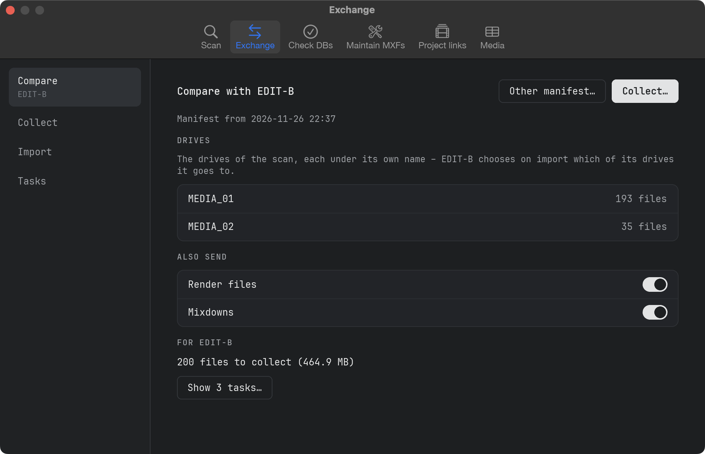
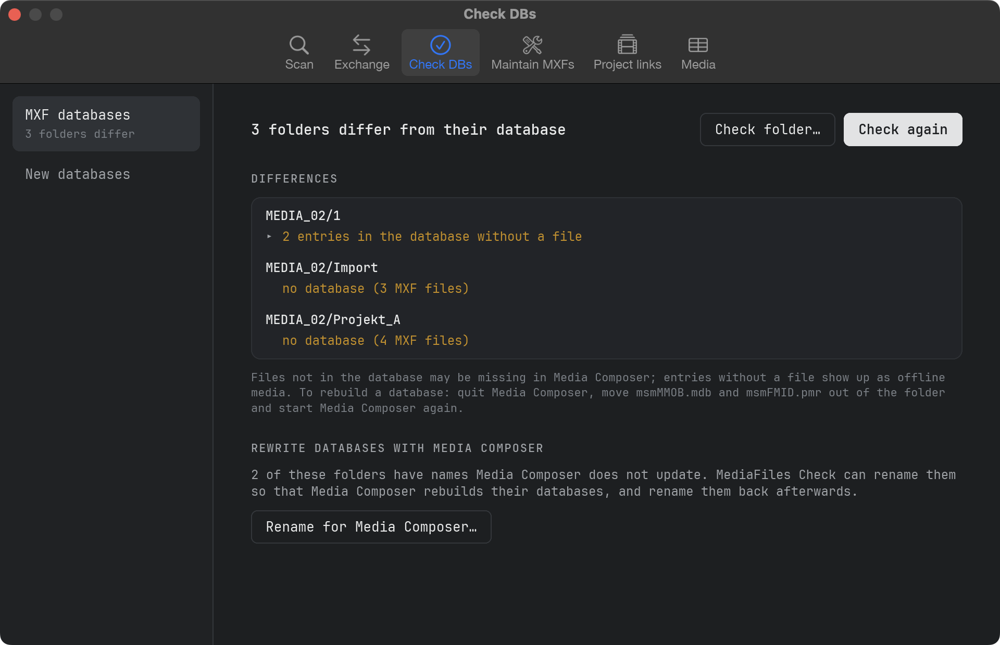
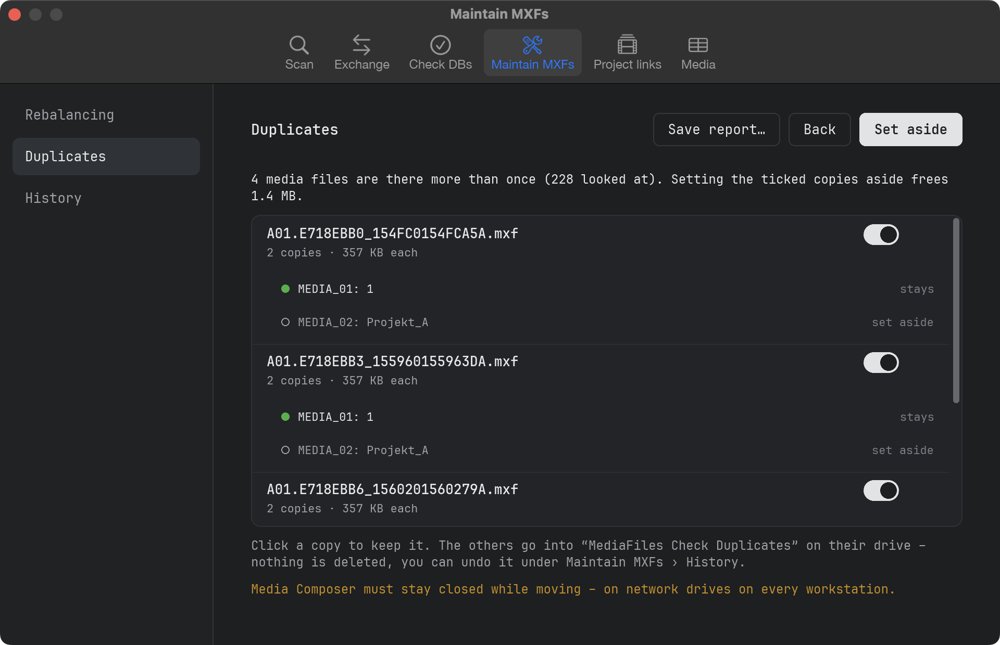
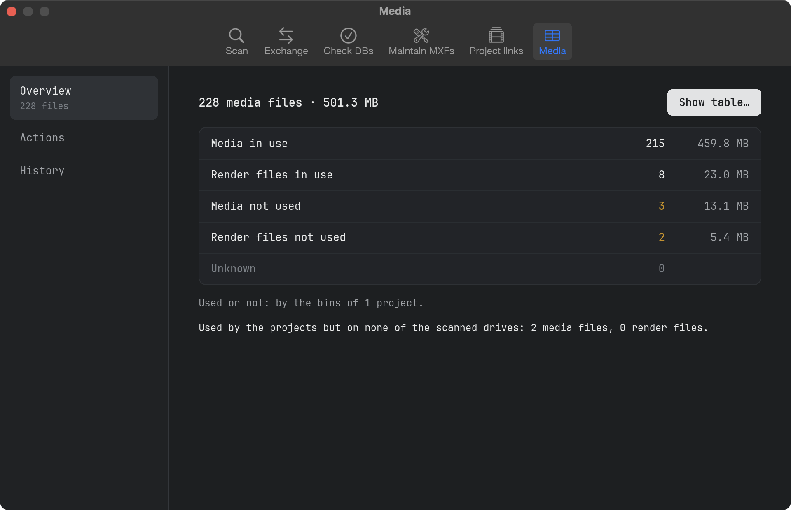

# Manual

## What MediaFiles Check does

MediaFiles Check looks after the Avid media files (MXF) of your edit systems:

- **Scan** reads the drives and Avid projects once; every other tab works with that scan.
- **Exchange** keeps the media of two edit systems in step, even when they are not connected.
- **Check DBs** compares every folder in `Avid MediaFiles/MXF` with its Avid database, shows where the two don't match and has Media Composer write new databases (Rename for Media Composer).
- **Maintain MXFs** has the tools that move files: rebalancing, duplicates, and their history.
- **Project links** finds the media files the bins of your Avid projects need that are on none of the drives, and requests them.
- **Media** lists every media file with clip, codec and size, separates render files and sets unused files aside.

MediaFiles Check **never deletes** a media file and **never overwrites** one. Checking only reads.

## The window

The tabs at the top are the areas. Inside each tab, the sidebar on the left lists its steps in the order you do them; under each step a short line says where it stands. A small orange dot on a tab means something waits there. Errors show as a note at the bottom of the window; **×** closes it. A new version shows as a card there too.

Every scan (Scan, Check DBs, Rebalancing, Duplicates) shows the time left and two buttons under its bar: **Pause** stops reading until you click **Resume**; **Cancel** ends the scan at once and goes back – nothing of it is kept (checksums and headers already read are remembered for the next scan).

If macOS was told not to let MediaFiles Check read a drive, a scan stops with “macOS does not let MediaFiles Check read: …”. **Ask for access again** makes macOS ask once more – click Allow. If it stays blocked, System Settings opens at Privacy & Security › Files & Folders: switch the drives on there.

## What it expects

On every drive, including network drives:

- `Avid MediaFiles/MXF/<folder>/` with the `.mxf` media files
- the two Avid database files `msmFMID.pmr` and `msmMMOB.mdb` in each folder
- `Creating` folders and hidden files are ignored

Folder names can be anything, e.g. `1`, `Avid8.1` or `Mac Studio.1`. Every connected drive with `Avid MediaFiles/MXF` has a switch; the same switches apply to every tab, and they are remembered. New drives are switched on.

## Scan

The **Scan** tab comes first: its scan is the basis for the other tabs.

1. Scan › **Scan**: switch on the connected drives and the Avid Media Composer projects whose bins count (**Projects folder…** chooses the folder they are in), then **Scan volumes & projects**. The first scan reads the header of every media file and every bin; later ones only new or changed files and bins (a bin Media Composer saved since). After a few seconds the time left shows on the right under the bar. When it is done, the page says which scan is current.
2. Scan › **History**: the newest 20 scans. **Load…** first checks that its volumes and projects are reachable – if not, it says which to connect. Then it makes the scan current again without scanning: back on the Scan page, its volumes and projects are switched on and the volumes show when they were scanned. **×** removes a scan (asks first); **Delete all…** asks first.

The scan also writes Exchange's *manifest*: every MXF file of the switched-on drives with a checksum – a list of files, no media. The first scan reads every file once, so it takes longer; later scans only read new or changed files. Loading a scan from the History makes its manifest current again (scans saved before this version have none).

## Exchange: compare and collect

Exchange › **Compare** → **Save manifest…** saves the manifest of the last scan as e.g. `261101-1312_Mac Studio_Manifest.mfexchange`. Send it to the other system, e.g. by e-mail or USB stick. Without a scan the page says **No scan yet** – **Go to Scan**.

1. Scan this system first under Scan, so that your own manifest is up to date.
2. Exchange › **Compare** → **Open manifest…** and choose the manifest of the other system – or a request saved under Project links › Request.
3. **Drives and what goes along:** the page lists the drives of the scan – each goes under its own name, the other workstation chooses on import which of its drives it goes to. Which drives go is decided by what you scan. Under **Also send**, switch off **Render files** or **Mixdowns** to leave them out (recognised by their MXF header; a folder that ends up without them gets the task “Rebuild database” instead of its database). The choice is remembered. With an older scan the page asks you to scan again first.
4. Check the number of files – **Show … tasks…** opens the tasks in a window of their own – then click **Collect…** and choose where the delivery folder should be created.

Every file is copied with a checksum check into a new folder like `261102-1830_Mac Studio_to_MacBook`, together with `Tasks.txt` (instructions for importing by hand). Collecting again after an interruption continues where it stopped. **Too little space:** if the delivery does not fit (1 GB stays free on every drive), MediaFiles Check asks for another place – on another drive – and splits the delivery into parts (`…_part1of2`, `…_part2of2`), a folder kept together where possible.

## Exchange: import

1. Quit Media Composer.
2. Exchange › **Import** → **Choose delivery…**. A delivery collected for another system is refused – import it there. A delivery in parts: select all its folders together in the dialog – a missing part stops the import before anything is copied.
3. Every drive of the delivery needs a drive on this system; drives with the same name are assigned automatically. With **Separate**, media files go to one drive and render files to another (recognised by their MXF header).
4. **Folders:** the page shows how many folders merge; **Choose folders…** opens a window with every folder of the delivery:  **Merge** (into the folder of the same name) or **Own folder** (`<sender>_<folder>`, e.g. `Mac Studio_1`; if it exists already, the files go into it). **All merge** / **All in own folders** sets every folder.
5. **Verify & import** first verifies every file. Only a complete, undamaged delivery is imported – files are only added, a media file is never overwritten. Replaced databases are kept in `Avid MediaFiles/Exchange-Backup/`.
6. Scan again under Scan afterwards, so that the manifest is up to date.

## Exchange: tasks

Exchange › **Tasks** lists the tasks of deliveries collected or imported here – e.g. “Rebuild database” or “Same name, different content”. Only tasks for this workstation are listed; tasks for the other workstation go with the delivery (`Tasks.txt`, also with instructions for importing by hand). **Check…** checks a folder of this system that needs a new database; **Done** moves a task down to Completed, **Reopen** brings it back, **Clear completed** removes the completed ones. Databases still to be rewritten after rebalancing or duplicates are in the History of Maintain MXFs; folders waiting to be renamed back under Check DBs › New databases. After collecting or importing, **Show tasks** on the result page opens this list when there are tasks for this workstation.

## When is something copied?

A file counts as **present** if it exists anywhere on the other system with the same name and checksum.

- **Folder identical on both sides:** nothing happens.
- **Folder missing on the other side:** the whole folder is copied, including its database.
- **One side has additional files:** the files and the database of the fuller side are copied.
- **Both sides have files of their own:** only the files are copied – task “Rebuild database”.
- **Same file name, different content:** not copied – a task asks you to check it.

A database is only delivered if the target folder ends up exactly like the source folder; a database is never deleted. The same holds when importing: a folder that ends up different from the other side – merged, copied into an own folder that already exists, or separated into media and render files – keeps its database, and Exchange › Tasks lists “Rebuild database”.

## Check the MXF databases

Every folder in `Avid MediaFiles/MXF` has two Avid database files, `msmFMID.pmr` and `msmMMOB.mdb`; they tell Media Composer which media files are in it. Check DBs › **MXF databases** reads them and compares them with the MXF files really in the folder. Nothing is changed.

**Check** checks the volumes of the current scan (Scan tab) that are connected; without a scan the page offers **Go to Scan**. **Check folder…** checks a place you choose: a drive, the `MXF` folder, a single folder like `MXF/1`, or a copy on a backup drive. The result shows on the same page – **Check again** after Media Composer has rebuilt a database. It lists every folder that differs:

- **n files not in the database** – Media Composer may not show them.
- **n entries in the database without a file** – they show up as offline media.
- **no database** / **msmFMID.pmr is missing** (or msmMMOB.mdb) / **database is empty**.
- **database unreadable** – an unknown format. MediaFiles Check never guesses.

Click a finding to show up to 10 of its file names; they are closed at first. Folders Media Composer does not update itself get **Rename for Media Composer…** right there.

## Rename for Media Composer

Media Composer only rebuilds the databases of its own folders: numbered folders like `1` on local drives, `<computer name>.<number>` on network drives. Other folders – e.g. copied from another system – keep their old database. Check DBs › **New databases** shows the flow at the top: Rename — Media Composer writes — Rename back.

1. Quit Media Composer and rename the folders (from the check result, or when rebalancing or setting duplicates aside). Each gets the next free number; the original name and every media file are remembered.
2. **Start Media Composer** and wait until it has scanned the drives. The dot of a folder turns green once Media Composer has written its database.
3. Quit Media Composer and click **Rename back**.

**Rename back** first shows every renamed folder on one page, each with its state: *ready*, *database not rewritten yet*, *files missing or changed* or *new files* (usually recorded while the folder had the new name). All folders are ticked – untick the ones that should stay renamed for now. If a ticked folder has new files, choose once for all where they go: keep them in the folder, a new folder, or folder `1` (`<computer name>.1` on network drives). **Rename back (n)** then renames all ticked folders at once.

The original names are saved before anything is renamed, so they survive a crash or a restart. A folder is recognised by its drive, its current name and its media files; a drive that comes back under another name is found again. A renamed folder that was deleted or moved away by hand is dropped from the list.

As long as folders are renamed, nothing else renames folders or rewrites databases – neither the check result nor Rebalancing, Duplicates or Media (their buttons are disabled and say so). Rename the folders back first.

## Rebalancing

We recommend no more than 5000 files per MXF folder. The limit (Settings → Rebalancing) counts every file of a folder, the two database files included.

A folder and its rebalanced folders (`<name>-rebalanced-1`, `-2` …) belong together. Rebalancing lays out the whole group: the oldest media files go into `-rebalanced-1`, the next into `-2` …, the youngest stay in the main folder. The video and audio files of a clip stay together, so a folder can end a few files below the limit. Maintain MXFs › **Rebalancing** → **Find full MXF folders…** lists every group on the switched-on drives that does not match the limit.

1. Quit Media Composer – on network drives on every workstation – and choose the groups.
2. Click **Rebalance**. For a folder Media Composer creates itself (`1`, `<computer name>.1`) we recommend giving it a name of its own first. Nothing is copied or deleted; a rebalanced folder left without media files goes into `MediaFiles Check Database Backups` as a whole.
3. Afterwards the databases of the changed folders have to be rewritten. **Rebalanced** lists every group in a list of its own. **Set old databases aside** puts their database files into `MediaFiles Check Database Backups` on the same drive and renames the folders Media Composer does not update itself. The page after it explains the next step; **Have databases rewritten** takes you to Check DBs › New databases. **Cancel** leaves the databases as they are – the Rebalancing page then says so and offers **Set old databases aside** for every waiting run.

Every change of the limit asks first; the next **Find full MXF folders…** lays out every group anew.

## Duplicates

Maintain MXFs › **Duplicates** → **Find duplicates…** looks through the switched-on drives for media files that are there more than once – by their Media Composer ID, so renamed copies are found too; files without an ID by name, size and checksum. Mountpoint workspaces are left out.

The green dot marks the copy that stays (the one its folder's database knows, otherwise the oldest) – click another copy to keep that one. Copies with the same ID but different sizes are not switched on by themselves. **Set aside** moves the other copies into `MediaFiles Check Duplicates` on their drive; a folder left without media files goes along. Then the databases are rewritten as for rebalancing.

## History

Maintain MXFs › **History** lists every rebalancing and duplicates run, newest first; it grows group by group while a rebalancing is running. A run whose databases are not rewritten yet says so.

**Undo** moves everything back (never over an existing file) – rename renamed folders back first. **×** removes one entry, **Delete all…** all of them (both ask first); nothing on the drives changes, but the run can then no longer be undone. While a run or an undo is going, its progress shows the folder and file it is working on.

## Project links

1. Projects works with the current scan from the **Scan** tab: the projects switched on there (every folder with an `.avp` file in the chosen projects folder; `Attic` is left out). The missing media are worked out with every scan and kept in its History. Without a scan with projects, Projects offers **Go to Scan**.
2. **Missing media** lists per bin every missing media file in three columns: the clip as it is named in the bin, the MXF file name and the original file (camera clip, tape or imported file). The MXF name is only known while an Avid database on the drives still lists the file, otherwise it shows “–”. Click the arrow to see where a file is used; click any name to copy it to the clipboard. Drag the column edges in the header to make a column wider, and the divider between the tree and the list to give the tree more room. The window can be resized; at the top choose **All**, **To relink**, **Missing** or **Files only** (every missing file once, without bins). To pass it on, save a request (see below). On the left is the folder tree of the scanned projects (closed at first – click the arrow to open a folder): untick a folder (or a whole project) and its bins drop out of every view and every count – a file used only there is no longer listed. Ticking a folder also ticks the folders above it, so its bins show up. **All**, **None** and **Invert** at the top right of the tree change every tick at once. The request takes only the files of the ticked folders.
   AMA-linked files are not requested; the same page counts them, and **Show AMA clips…** next to **Show media…** opens where they are used.
3. **Request** → **Save request…** writes a `…_Request.mfexchange` file. Send it to the system that has the media; there: Exchange › Compare, open it, then Collect. Here: Exchange › Import the delivery.

Good to know:

- Clips are matched with their media by Avid's media IDs, not by file names. A file in no Avid database is identified by the ID in its MXF header.
- A missing file whose source is on the drives in another media file is marked **on the drives – relink**: relink it in Media Composer. It is not requested.
- Files without an Avid media reference (e.g. imported via AAF) are counted separately; the exchange only finds them if the other system has them in Avid MediaFiles.
- Camera sound tracks that never had a media file, and missing render files, are only counted.

## Media

1. Media works with the current scan from the **Scan** tab. Without one it offers **Go to Scan**.
2. **Overview** counts media and render files, in use or not, and how many files the projects use that are on none of the scanned drives. **Show table…** opens the media table: every file with clip, kind, codec, picture, fps, duration, sound, size, project and folder – filter, search, sort by a column, double-click a column edge to fit it to its longest entry, select files, **Save list…**.

How a file is sorted:

- **Render**: Media Composer marks every render file in its header; a render file an effect still uses is also known from the bins.
- **Media**: everything else Media Composer or another program wrote. A file nothing tells apart stays **Unknown** and is never moved by a rule.
- **Not used**: no clip, sequence or effect of the switched-on projects uses it. Media of other projects on the same drives count as unused too – switch on every project that uses these drives.

Media › **Actions** (its own step, Media Composer must be closed; each one shows a preview first):

- **Render files into folders of their own**: render files go into folders like `Mac Studio-renderfiles-1` next to their folder, at most as many as the rebalancing limit allows.
- **Swap**: choose the import drive and the render drive. Render files on the import drive go to the render drive, media on the render drive to the import drive, each into a folder of the same name. Every file is copied and the copy checked by checksum; then the original is deleted or put into `MediaFiles Check Aside` – you choose each time.
- **Set aside**: choose what goes – render files no switched-on project uses (on by default), also render files in use (Media Composer renders them again), media files no switched-on project uses (off by default, so media stay). Folders you switch off in the list stay as they are and are remembered, e.g. sound effect libraries. Files selected in the table can be set aside too. Everything goes into `MediaFiles Check Aside` on its drive.
- **Media of a bin**: choose a bin (`.avb`); every media file its clips, subclips and sequences use – also from other bins of the project, optionally with the render files of its sequences – is copied or moved to the target drive, into a folder of the same name. Files already there stay.

Nothing is ever overwritten; a file changed since the scan stays where it is. Afterwards the databases of the changed folders are rewritten as for rebalancing. Media › **History** lists every run: **Rewrite databases**, **Undo**.

## Rebuild a database

1. Quit Media Composer.
2. Move `msmMMOB.mdb` and `msmFMID.pmr` out of the folder, e.g. into a folder on the desktop. Don't delete them until everything works again.
3. Start Media Composer. It writes a new database for the folder.
4. Check the folder again.

For folders Media Composer does not update itself, use Check DBs › New databases instead.

## Settings

**MediaFiles Check → Settings…** (⌘,) opens the settings window: **General** (Light/Dark, language), **Rebalancing** (files per folder), **Updates**, **Support** and **About**.

## Updates

MediaFiles Check looks for a new version on GitHub shortly after starting and every 6 hours; **Settings… → Updates → Check for updates** looks right away. A new version shows as a card at the bottom of the main window (**×** hides it until the next start): **What's new** opens the release notes, **Install update** downloads it, checks that it is complete and unchanged, puts the old version in the Trash and restarts the app. **Get test versions** also offers versions that are still being tested.

## Support

**Settings… → Support**:

- **Run self-test…** checks reading databases, comparing, renaming and updates on test data of its own. **Send report** sends the result anonymously; **Save report** puts it in Downloads.
- **Report…** sends us a problem or an idea – no GitHub account needed.
- **Show log file** (see below).
- **Buy me a coffee** – if you use MediaFiles Check and like it, I would be glad about a coffee.

If sending fails, the report is saved in Downloads.

## Log file

MediaFiles Check writes what it does – checks, scans, deliveries, renames, errors – to a log file. **Help → Show Log File** shows it in the Finder; send it along when you report a problem.
