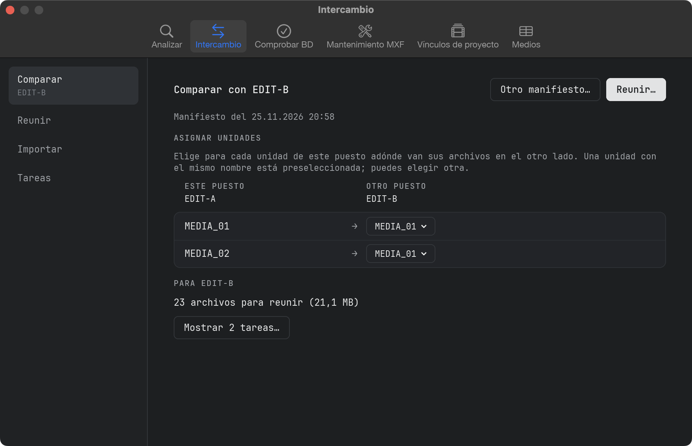
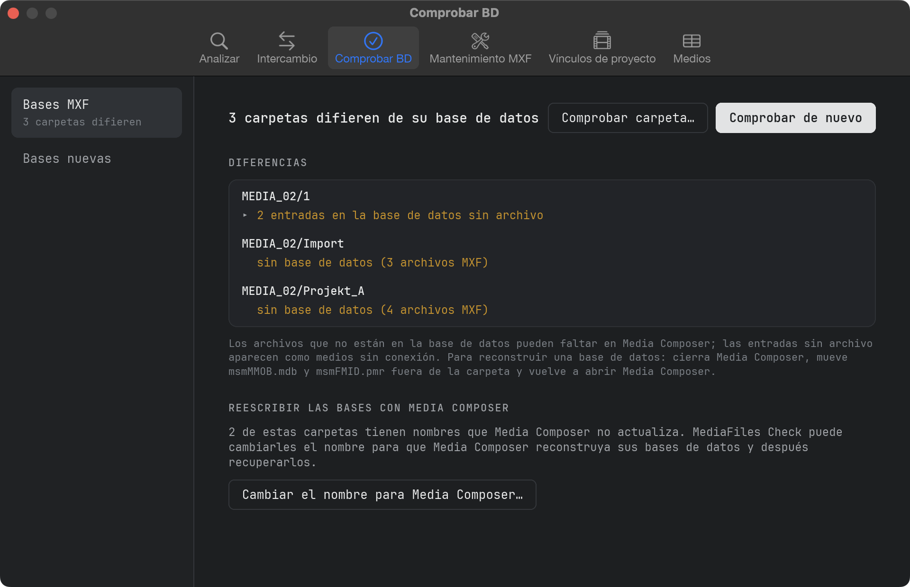
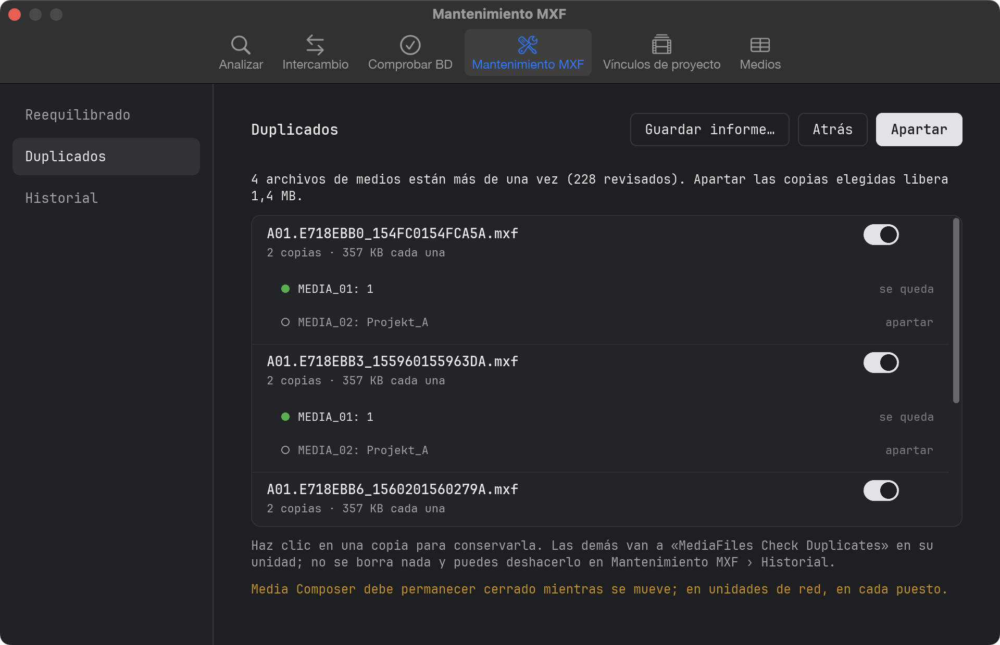
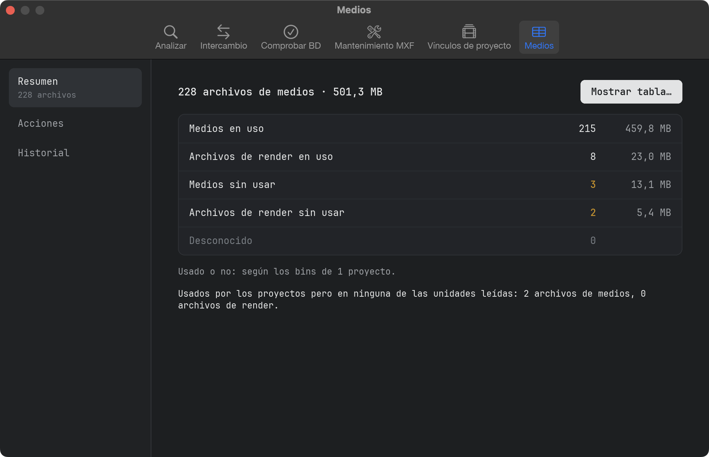

# Manual

## Qué hace MediaFiles Check

MediaFiles Check cuida de los archivos de medios de Avid (MXF) de tus puestos de edición:

- **Intercambio** mantiene al día los medios de dos puestos, aunque no estén conectados (antes MediaFiles Ferry).
- **Comprobar BD** compara cada carpeta de `Avid MediaFiles/MXF` con su base de datos de Avid y muestra dónde no coinciden.
- **Mantenimiento MXF** reúne las herramientas que cambian algo: renombrar carpetas para Media Composer, reequilibrado, duplicados y su historial.
- **Vínculos de proyecto** encuentra los archivos de medios que necesitan los bins de tus proyectos de Avid y que no están en ninguna unidad, y los solicita.
- **Medios** muestra cada archivo de medios con clip, códec y tamaño, separa los archivos de render y aparta los archivos sin usar.

MediaFiles Check **nunca borra** un archivo de medios y **nunca sobrescribe** ninguno. Comprobar solo lee.

## La ventana

Las pestañas de arriba son las áreas. Dentro de cada pestaña, la barra lateral de la izquierda muestra sus pasos en el orden en que se hacen; bajo cada paso, una línea corta indica cómo está. Un pequeño punto naranja en una pestaña indica que algo espera allí.

Cada análisis (Analizar, Comprobar, Reequilibrado, Duplicados, Proyectos, Medios) muestra bajo su barra el tiempo restante y dos botones: **Pausa** detiene la lectura hasta que pulses **Reanudar**; **Cancelar** termina el análisis enseguida y vuelve atrás; no se guarda nada de él (las sumas de comprobación y cabeceras ya leídas se recuerdan para el siguiente análisis).

Si se le dijo a macOS que no deje a MediaFiles Check leer una unidad, el análisis se detiene con «macOS no deja que MediaFiles Check lea: …». **Volver a pedir acceso** hace que macOS pregunte otra vez: pulsa Permitir. Si sigue bloqueado, se abre Ajustes del Sistema en Privacidad y seguridad › Archivos y carpetas: activa allí las unidades.

## Qué se espera

En cada unidad, también en unidades de red:

- `Avid MediaFiles/MXF/<carpeta>/` con los archivos de medios `.mxf`
- los dos archivos de base de datos de Avid `msmFMID.pmr` y `msmMMOB.mdb` en cada carpeta
- las carpetas `Creating` y los archivos ocultos se ignoran

Las carpetas pueden llamarse como sea, p. ej. `1`, `Avid8.1` o `Mac Studio.1`. Cada unidad conectada con `Avid MediaFiles/MXF` tiene un interruptor; los mismos interruptores valen para todas las pestañas, y se recuerdan. Las unidades nuevas quedan activadas.

## Analizar

La pestaña **Analizar** va primero: su análisis es la base de las demás pestañas.

1. Analizar › **Analizar**: activa las unidades conectadas y los proyectos de Avid Media Composer cuyos bins cuentan (**Carpeta de proyectos…** elige la carpeta donde están) y pulsa **Analizar volúmenes y proyectos**. El primer análisis lee la cabecera de cada archivo de medios y cada bin; los siguientes solo los archivos y bins nuevos o cambiados (un bin que Media Composer ha guardado desde entonces). A los pocos segundos aparece a la derecha, bajo la barra, el tiempo restante. Después, la página indica qué análisis es el actual.
2. Analizar › **Historial**: los 20 análisis más recientes. **Cargar…** comprueba primero que sus volúmenes y proyectos estén accesibles; si no, dice qué conectar. Después el análisis vuelve a ser el actual sin leer de nuevo: de vuelta en la página Analizar, sus volúmenes y proyectos están activados y los volúmenes muestran cuándo se analizaron. **×** quita un análisis al instante; **Borrar todos…** pregunta antes.

El análisis también escribe el *manifiesto* de Intercambio: cada archivo MXF de las unidades activadas con una suma de comprobación; una lista de archivos, sin medios. Para ello el primer análisis lee cada archivo una vez y tarda más; los siguientes solo leen archivos nuevos o modificados. Un análisis cargado desde el Historial vuelve a hacer actual su manifiesto (los guardados antes de esta versión no tienen).

## Intercambio: comparar y reunir

Intercambio › **Comparar** → **Guardar manifiesto…** guarda el manifiesto del último análisis p. ej. como `261101-1312_Mac Studio_Manifest.ferry`. Envíalo al otro puesto, p. ej. por correo o memoria USB. Sin análisis, la página dice **Aún no hay análisis**: **Ir a Analizar**.

1. Analiza primero este puesto en Analizar para que tu manifiesto esté al día.
2. Intercambio › **Comparar** → **Abrir manifiesto…** y elige el manifiesto del otro puesto, o una solicitud guardada en Vínculos de proyecto › Solicitar.
3. **Asignar unidades:** a la izquierda tus unidades (este puesto), a la derecha adónde van en el otro puesto. Una unidad con el mismo nombre allí está preseleccionada, pero puedes elegir otra; una unidad sin equivalente necesita un destino, o **No enviar**. La elección se recuerda.
4. Revisa el número de archivos (**Mostrar … tareas…** abre las tareas en una ventana aparte); luego haz clic en **Reunir…** y elige dónde crear la carpeta de entrega.

Cada archivo se copia con control de suma en una carpeta nueva como `261102-1830_Mac Studio_to_MacBook`, junto con `Tasks.txt` (instrucciones para importar a mano). Reunir de nuevo tras una interrupción continúa donde se quedó.

## Intercambio: importar

1. Cierra Media Composer.
2. Intercambio › **Importar** → **Elegir entrega…**.
3. Cada unidad de la entrega necesita una unidad en este puesto; las del mismo nombre se asignan solas. Con **Separar**, los archivos de medios van a una unidad y los de render a otra (se reconocen por su cabecera MXF).
4. **Carpetas:** la página muestra cuántas carpetas se combinan; **Elegir carpetas…** abre una ventana con todas las carpetas de la entrega: para cada carpeta **Combinar** (en la carpeta con el mismo nombre) o **Carpeta propia** (`<remitente>_<carpeta>`, p. ej. `Mac Studio_1`; si ya existe, los archivos van ahí). **Combinar todas** / **Todas en carpetas propias** lo elige para todas.
5. **Verificar e importar** verifica primero cada archivo. Solo se importa una entrega completa y sin daños: los archivos solo se añaden, nunca se sobrescribe un archivo de medios. Las bases de datos reemplazadas se guardan en `Avid MediaFiles/Ferry-Backup/`.
6. Después vuelve a analizar en Analizar para que el manifiesto esté al día.

## Intercambio: tareas

Intercambio › **Tareas** muestra las tareas de las entregas reunidas o importadas aquí, p. ej. «Reconstruir la base de datos» o «Mismo nombre, contenido distinto». Solo aparecen las tareas para este puesto; las del otro puesto van con la entrega (`Tasks.txt`, también con las instrucciones para importar a mano). **Comprobar…** comprueba una carpeta de este puesto que necesita una base nueva; **Listo** pasa una tarea abajo a Hechas, **Reabrir** la recupera, **Quitar las hechas** limpia la lista. Las bases que aún hay que reescribir tras un reequilibrado o duplicados están en el Historial de Mantenimiento MXF; las carpetas que esperan recuperar su nombre, en Comprobar BD › Bases nuevas.

## ¿Cuándo se copia algo?

Un archivo cuenta como **presente** si existe en algún lugar del otro puesto con el mismo nombre y la misma suma de comprobación.

- **Carpeta idéntica en ambos lados:** no pasa nada.
- **Carpeta ausente en el otro lado:** se copia la carpeta entera, con su base de datos.
- **Un lado tiene archivos de más:** se copian los archivos y la base de datos del lado más completo.
- **Ambos lados tienen archivos propios:** solo se copian los archivos; tarea «Reconstruir la base de datos».
- **Mismo nombre de archivo, contenido distinto:** no se copia; una tarea pide comprobarlo.

Una base de datos solo se entrega si la carpeta de destino queda exactamente como la de origen; nunca se borra una base de datos. Al importar ocurre lo mismo: una carpeta que después no coincide con la del otro lado (combinada, copiada en una carpeta propia que ya existía o separada en medios y render) conserva su base de datos, y en Intercambio › Tareas aparece «Reconstruir la base de datos».

## Comprobar las bases MXF

Cada carpeta de `Avid MediaFiles/MXF` tiene dos archivos de base de datos de Avid, `msmFMID.pmr` y `msmMMOB.mdb`; indican a Media Composer qué archivos de medios contiene. Comprobar BD › **Bases MXF** los lee y los compara con los archivos MXF que hay realmente en la carpeta. No se cambia nada.

**Comprobar** comprueba los volúmenes conectados del análisis actual (pestaña Analizar); sin análisis, la página ofrece **Ir a Analizar**. **Comprobar carpeta…** comprueba un lugar que elijas: una unidad, la carpeta `MXF`, una sola carpeta como `MXF/1` o una copia en una unidad de respaldo. El resultado aparece en la misma página: **Comprobar de nuevo** cuando Media Composer haya reconstruido una base. Muestra cada carpeta que difiere:

- **Archivos que no están en la base de datos**: puede que Media Composer no los muestre.
- **Entradas de la base de datos sin archivo**: aparecen como medios sin conexión.
- **Sin base de datos** / **falta msmFMID.pmr o msmMMOB.mdb** / **base de datos vacía**.
- **Base de datos ilegible**: un formato desconocido. MediaFiles Check nunca adivina.

Se muestran hasta 10 nombres de archivo por hallazgo. Las carpetas que Media Composer no actualiza por sí mismo tienen ahí mismo **Cambiar el nombre para Media Composer…**.

## Renombrar para Media Composer

Media Composer solo reconstruye las bases de datos de sus propias carpetas: carpetas numeradas como `1` en unidades locales, `<nombre del equipo>.<número>` en unidades de red. Las demás carpetas, p. ej. copiadas de otro puesto, conservan su base de datos antigua. Comprobar BD › **Bases nuevas** muestra el proceso arriba: Renombrar — Media Composer escribe — Recuperar el nombre.

1. Cierra Media Composer y renombra las carpetas (desde el resultado de la comprobación, o al reequilibrar o apartar duplicados). Cada una recibe el siguiente número libre; se recuerdan el nombre original y cada archivo de medios.
2. **Abrir Media Composer** y espera a que haya leído las unidades. El punto de una carpeta se pone verde cuando Media Composer ha escrito su base de datos.
3. Cierra Media Composer y haz clic en **Recuperar el nombre**.

**Recuperar el nombre** muestra primero todas las carpetas renombradas en una página, cada una con su estado: *lista*, *base aún no reescrita*, *archivos que faltan o cambiaron* o *archivos nuevos* (casi siempre grabados mientras la carpeta tenía el nombre nuevo). Todas están marcadas: desmarca las que deban quedarse renombradas por ahora. Si una carpeta marcada tiene archivos nuevos, elige una sola vez para todas adónde van: dejarlos en la carpeta, una carpeta nueva o la carpeta `1` (`<nombre del ordenador>.1` en unidades de red). **Recuperar el nombre (n)** cambia entonces el nombre de todas las carpetas marcadas a la vez.

Los nombres originales se guardan antes de renombrar nada, así sobreviven a un fallo o a un reinicio. Una carpeta se reconoce por su unidad, su nombre actual y sus archivos de medios; una unidad que vuelve con otro nombre se encuentra de nuevo. Una carpeta renombrada que se borró o se movió a mano desaparece de la lista.

Mientras haya carpetas renombradas, nada más renombra carpetas ni reescribe bases de datos: ni el resultado de la comprobación, ni el reequilibrado, los duplicados o los medios (sus botones quedan desactivados, con un aviso). Devuelve primero el nombre a las carpetas.

## Reequilibrado

Recomendamos no más de 5000 archivos por carpeta MXF. El límite (Ajustes → Reequilibrado) cuenta cada archivo de una carpeta, incluidos los dos archivos de base de datos.

Una carpeta y sus carpetas reequilibradas (`<nombre>-rebalanced-1`, `-2` …) van juntas. El reequilibrado reparte todo el grupo: los archivos de medios más antiguos van a `-rebalanced-1`, los siguientes a `-2` …, los más recientes se quedan en la carpeta principal. Los archivos de vídeo y audio de un clip se quedan juntos, así que una carpeta puede quedar unos archivos por debajo del límite. Mantenimiento MXF › **Reequilibrado** → **Buscar carpetas llenas…** muestra cada grupo de las unidades activadas que no cumple el límite.

1. Cierra Media Composer (en unidades de red, en cada puesto) y elige los grupos.
2. Haz clic en **Reequilibrar**. Para una carpeta que crea Media Composer (`1`, `<nombre del equipo>.1`) recomendamos darle antes un nombre propio. No se copia ni se borra nada; una carpeta reequilibrada sin archivos de medios va entera a `MediaFiles Check Database Backups`.
3. Después hay que reescribir las bases de datos de las carpetas modificadas. **Iniciar** pone sus archivos de base de datos en `MediaFiles Check Database Backups` en la misma unidad y renombra las carpetas que Media Composer no actualiza por sí mismo; sigue en Comprobar BD › Bases nuevas. **Cancelar** deja las bases de datos como están; queda en Tareas e Historial.

Cada cambio del límite pregunta antes; la siguiente **Buscar carpetas llenas…** vuelve a repartir cada grupo.

## Duplicados

Mantenimiento MXF › **Duplicados** → **Buscar duplicados…** busca en las unidades activadas archivos de medios que están más de una vez, por su ID de Media Composer, así que también encuentra copias renombradas; los archivos sin ID, por nombre, tamaño y suma de comprobación. Los espacios de trabajo de Mountpoint se dejan fuera.

El punto verde marca la copia que se queda (la que conoce la base de datos de su carpeta; si no, la más antigua); haz clic en otra copia para quedarte con ella. Las copias con el mismo ID pero distinto tamaño no se activan solas. **Apartar** mueve las demás copias a `MediaFiles Check Duplicates` en su unidad; una carpeta que se queda sin archivos de medios va con ellas. Después se reescriben las bases de datos como en el reequilibrado.

## Historial

Mantenimiento MXF › **Historial** muestra cada operación de reequilibrado y de duplicados: **Reescribir bases de datos** hace el paso de las bases más tarde, **Deshacer** lo devuelve todo (nunca sobre un archivo existente); recupera antes el nombre de las carpetas renombradas.

## Vínculos de proyecto

1. Proyectos trabaja con el análisis actual de la pestaña **Analizar**: los proyectos activados allí (cada carpeta con un archivo `.avp` en la carpeta de proyectos elegida; `Attic` se deja fuera). Los medios que faltan se calculan en cada análisis y se guardan con él en el historial. Sin un análisis con proyectos, Proyectos ofrece **Ir a Analizar**.
2. **Medios que faltan** muestra por bin cada archivo de medios que falta en tres columnas: el clip tal como se llama en el bin, el nombre del archivo MXF y el archivo original (clip de cámara, cinta o archivo importado). El nombre MXF solo se conoce mientras una base de datos de Avid en las unidades aún lista el archivo; si no, aparece «–». Un clic en la flecha muestra dónde se usa un archivo; un clic en un nombre lo copia al portapapeles. Los bordes de las columnas en la cabecera y la separación entre el árbol y la lista se pueden arrastrar. La ventana se puede redimensionar; arriba eliges **Todos**, **Para volver a vincular**, **Faltan** o **Solo archivos** (cada archivo que falta una vez, sin bins). Para pasarla a otro, guarda una solicitud (ver abajo). A la izquierda está el árbol de carpetas de los proyectos analizados (cerrado al principio; la flecha abre una carpeta): desmarca una carpeta (o un proyecto entero) y sus bins desaparecen de cada vista y de cada número; un archivo usado solo allí ya no aparece. **Todos**, **Ninguna** e **Invertir** arriba a la derecha del árbol cambian todas las casillas a la vez. La solicitud solo contiene los archivos de las carpetas marcadas.
3. **Clips AMA** muestra dónde se usan los archivos vinculados por AMA. No se solicitan.
4. **Solicitar** → **Guardar solicitud…** escribe un archivo `…_Request.ferry`. Envíalo al puesto que tiene los medios; allí: Intercambio › Comparar, ábrelo y luego Reunir. Aquí: Intercambio › Importar la entrega.

Conviene saber:

- Los clips se relacionan con sus medios por los ID de medios de Avid, no por los nombres de archivo. Un archivo que no está en ninguna base de Avid se reconoce por el ID de su cabecera MXF.
- Un archivo que falta cuya fuente está en las unidades en otro archivo de medios se marca **en las unidades: volver a vincular**: vuelve a vincularlo en Media Composer. No se solicita.
- Los archivos sin referencia de medios de Avid (p. ej. importados por AAF) se cuentan aparte; el intercambio solo los encuentra si el otro puesto los tiene en Avid MediaFiles.
- Las pistas de sonido de cámara que nunca tuvieron archivo de medios y los archivos de render que faltan solo se cuentan.

## Medios

1. Medios trabaja con el análisis actual de la pestaña **Analizar**. Sin él, ofrece **Ir a Analizar**.
2. **Resumen** cuenta medios y archivos de render, en uso o no, y cuántos archivos usados por los proyectos no están en ninguna de las unidades leídas. **Mostrar tabla…** abre la tabla de medios: cada archivo con clip, tipo, códec, imagen, fps, duración, sonido, tamaño, proyecto y carpeta; filtrar, buscar, ordenar por columna, doble clic en el borde de una columna para ajustarla a su entrada más larga, seleccionar archivos, **Guardar lista…**.

Cómo se clasifica un archivo:

- **Render**: Media Composer marca cada archivo de render en su cabecera; un archivo de render que un efecto aún usa también se conoce por los bins.
- **Medio**: todo lo demás que escribió Media Composer u otro programa. Un archivo que nada distingue queda como **Desconocido** y nunca se mueve por una regla.
- **Sin usar**: ningún clip, secuencia ni efecto de los proyectos activados lo usa. Los medios de otros proyectos en las mismas unidades también cuentan como sin usar; activa todos los proyectos que usan estas unidades.

Medios › **Acciones** (paso propio, Media Composer debe estar cerrado; cada una muestra primero una vista previa):

- **Archivos de render en sus propias carpetas**: los archivos de render van a carpetas como `Mac Studio-renderfiles-1` junto a su carpeta, como máximo tantos como permite el límite de reequilibrado.
- **Intercambiar**: elige la unidad de importación y la de render. Los archivos de render de la unidad de importación van a la de render y los medios de la unidad de render a la de importación, cada uno a una carpeta con el mismo nombre. Cada archivo se copia y la copia se comprueba con una suma de control; después el original se borra o va a `MediaFiles Check Aside`: lo eliges cada vez.
- **Apartar**: elige qué se aparta: archivos de render que ningún proyecto activado usa (activado por defecto), también archivos de render en uso (Media Composer los vuelve a renderizar), archivos de medios que ningún proyecto activado usa (desactivado, para conservar los medios). Las carpetas que desactives en la lista se quedan como están y se recuerdan, p. ej. bibliotecas de efectos de sonido. También se pueden apartar los archivos seleccionados en la tabla. Todo va a `MediaFiles Check Aside` en su unidad.
- **Medios de un bin**: elige un bin (`.avb`); cada archivo de medios que usan sus clips, subclips y secuencias (también de otros bins del proyecto y, si quieres, con los archivos de render de sus secuencias) se copia o mueve a la unidad de destino, a una carpeta con el mismo nombre. Lo que ya está allí se queda.

Nunca se sobrescribe nada; un archivo cambiado desde el análisis se queda donde está. Después se reescriben las bases de datos de las carpetas cambiadas, como en el reequilibrado. Medios › **Historial** muestra cada operación: **Reescribir bases de datos**, **Deshacer**.

## Reconstruir una base de datos

1. Cierra Media Composer.
2. Saca `msmMMOB.mdb` y `msmFMID.pmr` de la carpeta, p. ej. a una carpeta del escritorio. No los borres hasta que todo vuelva a funcionar.
3. Abre Media Composer. Escribe una base de datos nueva para la carpeta.
4. Vuelve a comprobar la carpeta.

Para las carpetas que Media Composer no actualiza por sí mismo, usa en su lugar Comprobar BD › Bases nuevas.

## Ajustes

**MediaFiles Check → Ajustes…** (⌘,) abre la ventana de ajustes: **General** (Claro/Oscuro, idioma), **Reequilibrado** (archivos por carpeta), **Actualizaciones**, **Soporte** y **Acerca de**.

## Actualizaciones

MediaFiles Check busca una versión nueva en GitHub poco después de abrirse y cada 6 horas; **Ajustes… → Actualizaciones → Buscar actualizaciones** busca enseguida. Una versión nueva aparece como una barra bajo las pestañas: **Novedades** abre las notas de la versión, **Instalar actualización** la descarga, comprueba que está completa y sin cambios, lleva la versión antigua a la Papelera y reinicia la app. **Recibir versiones de prueba** ofrece también versiones que aún se están probando.

## Soporte

**Ajustes… → Soporte**:

- **Autoprueba…** comprueba la lectura de bases de datos, la comparación, el renombrado y las actualizaciones con sus propios datos de prueba. **Enviar informe** manda el resultado de forma anónima; **Guardar** lo deja en Descargas.
- **Informar…** nos envía un problema o una idea, sin cuenta de GitHub.
- **Ver registro** (ver abajo).
- **Invítame a un café**: si usas MediaFiles Check y te gusta, me alegrará un café.

Si el envío falla, el informe se guarda en Descargas.

## Archivo de registro

MediaFiles Check anota lo que hace (comprobaciones, análisis, entregas, renombrados, errores) en un archivo de registro. **Ayuda → Mostrar archivo de registro** lo muestra en el Finder; adjúntalo cuando informes de un problema.
