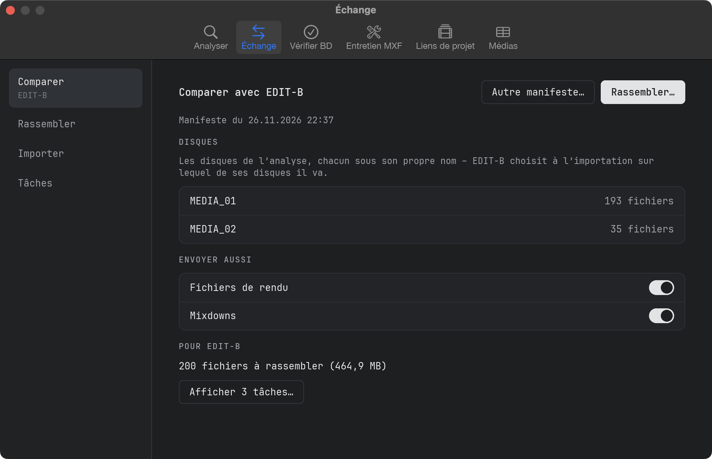
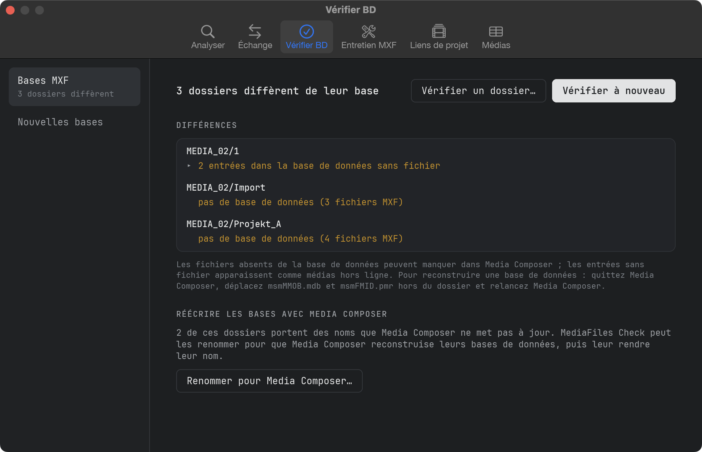
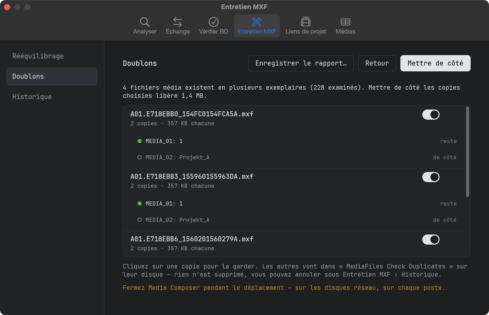
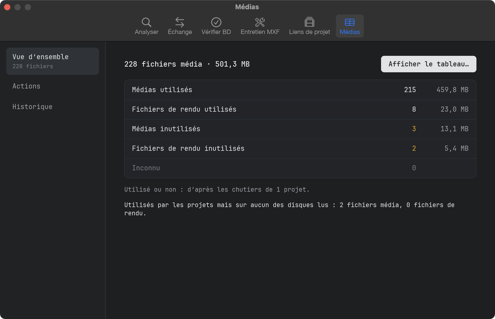

# Manuel

## Ce que fait MediaFiles Check

MediaFiles Check prend soin des fichiers média Avid (MXF) de vos postes de montage :

- **Échange** synchronise les médias de deux postes, même s’ils ne sont pas connectés.
- **Vérifier BD** compare chaque dossier de `Avid MediaFiles/MXF` à sa base de données Avid et montre où les deux ne concordent pas.
- **Entretien MXF** regroupe les outils qui modifient quelque chose : renommer des dossiers pour Media Composer, rééquilibrage, doublons et leur historique.
- **Liens de projet** trouve les fichiers média dont les chutiers de vos projets Avid ont besoin et qui ne sont sur aucun disque, et les demande.
- **Médias** liste chaque fichier média avec clip, codec et taille, sépare les fichiers de rendu et met de côté les fichiers inutilisés.

MediaFiles Check **ne supprime jamais** un fichier média et **n’en écrase jamais**. Vérifier ne fait que lire.

## La fenêtre

Les onglets en haut sont les domaines. Dans chaque onglet, la barre latérale à gauche liste ses étapes dans l’ordre où on les fait ; sous chaque étape, une courte ligne indique où elle en est. Un petit point orange sur un onglet signale que quelque chose y attend.

Chaque analyse (Analyser, Vérifier, Rééquilibrage, Doublons, Projets, Médias) affiche sous sa barre le temps restant et deux boutons : **Pause** arrête la lecture jusqu’à ce que vous cliquiez sur **Reprendre** ; **Annuler** termine l’analyse aussitôt et revient en arrière – rien n’en est gardé (les sommes de contrôle et en-têtes déjà lus sont mémorisés pour la prochaine analyse).

Si macOS a reçu l’ordre de ne pas laisser MediaFiles Check lire un disque, une analyse s’arrête avec « macOS ne permet pas à MediaFiles Check de lire : … ». **Redemander l’accès** fait reposer la question par macOS – cliquez sur Autoriser. Si cela reste bloqué, Réglages Système s’ouvre sur Confidentialité et sécurité › Fichiers et dossiers : activez-y les disques.

## Ce qui est attendu

Sur chaque disque, y compris les disques réseau :

- `Avid MediaFiles/MXF/<dossier>/` avec les fichiers média `.mxf`
- les deux fichiers de base de données Avid `msmFMID.pmr` et `msmMMOB.mdb` dans chaque dossier
- les dossiers `Creating` et les fichiers cachés sont ignorés

Les dossiers peuvent porter n’importe quel nom, p. ex. `1`, `Avid8.1` ou `Mac Studio.1`. Chaque disque connecté avec `Avid MediaFiles/MXF` a un interrupteur ; les mêmes interrupteurs valent pour tous les onglets, et ils sont mémorisés. Les nouveaux disques sont activés.

## Analyser

L’onglet **Analyser** vient en premier : son analyse sert de base aux autres onglets.

1. Analyser › **Analyser** : activez les disques connectés et les projets Avid Media Composer dont les chutiers comptent (**Dossier des projets…** choisit le dossier où ils se trouvent), puis **Analyser volumes et projets**. La première analyse lit l’en-tête de chaque fichier média et chaque chutier ; les suivantes seulement les fichiers et chutiers nouveaux ou modifiés (un chutier que Media Composer a enregistré depuis). Après quelques secondes, le temps restant s’affiche à droite sous la barre. Ensuite, la page indique quelle analyse est actuelle.
2. Analyser › **Historique** : les 20 analyses les plus récentes. **Charger…** vérifie d’abord que ses volumes et projets sont accessibles – sinon il indique quoi connecter. Ensuite l’analyse redevient actuelle sans nouvelle lecture : de retour sur la page Analyser, ses volumes et projets sont activés et les volumes indiquent quand ils ont été analysés. **×** retire une analyse (après confirmation) ; **Tout supprimer…** demande d’abord.

L’analyse écrit aussi le *manifeste* d’Échange : chaque fichier MXF des disques activés avec une somme de contrôle – une liste de fichiers, sans médias. La première analyse lit pour cela chaque fichier une fois et prend plus de temps ; les suivantes ne lisent que les fichiers nouveaux ou modifiés. Une analyse chargée depuis l’Historique rend son manifeste de nouveau actuel (les analyses enregistrées avant cette version n’en ont pas).

## Échange : comparer et rassembler

Échange › **Comparer** → **Enregistrer le manifeste…** enregistre le manifeste de la dernière analyse p. ex. sous `261101-1312_Mac Studio_Manifest.mfexchange`. Envoyez-le à l’autre poste, p. ex. par e-mail ou clé USB. Sans analyse, la page indique **Pas encore d’analyse** – **Aller à Analyser**.

1. Analysez d’abord ce poste sous Analyser, pour que votre manifeste soit à jour.
2. Échange › **Comparer** → **Ouvrir un manifeste…** et choisissez le manifeste de l’autre poste – ou une demande enregistrée sous Liens de projet › Demander.
3. **Associer les disques :** à gauche vos disques (ce poste), à droite leur destination sur l’autre poste. Un disque du même nom de l’autre côté est présélectionné, mais vous pouvez en choisir un autre ; un disque sans équivalent a besoin d’une cible – ou de **Ne pas envoyer**. Le choix est mémorisé.
4. Vérifiez le nombre de fichiers – **Afficher … tâches…** ouvre les tâches dans une fenêtre à part –, puis cliquez sur **Rassembler…** et choisissez où créer le dossier de livraison.

Chaque fichier est copié avec contrôle de somme dans un nouveau dossier comme `261102-1830_Mac Studio_to_MacBook`, avec `Tasks.txt` (instructions pour importer à la main). Rassembler à nouveau après une interruption reprend là où cela s’est arrêté.

## Échange : importer

1. Quittez Media Composer.
2. Échange › **Importer** → **Choisir la livraison…**.
3. Chaque disque de la livraison a besoin d’un disque sur ce poste ; les disques du même nom sont associés automatiquement. Avec **Séparer**, les fichiers média vont sur un disque et les fichiers de rendu sur un autre (reconnus par leur en-tête MXF).
4. **Dossiers :** la page indique combien de dossiers sont fusionnés ; **Choisir les dossiers…** ouvre une fenêtre avec tous les dossiers de la livraison : pour chaque dossier **Fusionner** (dans le dossier du même nom) ou **Dossier propre** (`<expéditeur>_<dossier>`, p. ex. `Mac Studio_1` ; s’il existe déjà, les fichiers y vont). **Tout fusionner** / **Tous dans des dossiers propres** règle tous les dossiers.
5. **Vérifier et importer** vérifie d’abord chaque fichier. Seule une livraison complète et intacte est importée – les fichiers sont seulement ajoutés, un fichier média n’est jamais écrasé. Les bases de données remplacées sont gardées dans `Avid MediaFiles/Exchange-Backup/`.
6. Analysez à nouveau ensuite sous Analyser, pour que le manifeste soit à jour.

## Échange : tâches

Échange › **Tâches** liste les tâches des livraisons rassemblées ou importées ici – p. ex. « Reconstruire la base de données » ou « Même nom, contenu différent ». Seules les tâches pour ce poste sont listées ; celles pour l’autre poste partent avec la livraison (`Tasks.txt`, avec aussi les instructions pour importer à la main). **Vérifier…** vérifie un dossier de ce poste qui a besoin d’une nouvelle base ; **Terminé** déplace une tâche vers Terminées, **Rouvrir** la ramène, **Retirer les terminées** fait le ménage. Les bases à réécrire après un rééquilibrage ou des doublons sont dans l’Historique d’Entretien MXF ; les dossiers qui attendent d’être renommés à l’origine sous Vérifier BD › Nouvelles bases.

## Quand quelque chose est-il copié ?

Un fichier est **présent** s’il existe quelque part sur l’autre poste avec le même nom et la même somme de contrôle.

- **Dossier identique des deux côtés :** rien ne se passe.
- **Dossier absent de l’autre côté :** le dossier entier est copié, avec sa base de données.
- **Un côté a des fichiers en plus :** les fichiers et la base de données du côté le plus complet sont copiés.
- **Les deux côtés ont leurs propres fichiers :** seuls les fichiers sont copiés – tâche « Reconstruire la base de données ».
- **Même nom de fichier, contenu différent :** pas copié – une tâche demande de vérifier.

Une base de données n’est livrée que si le dossier cible devient exactement comme le dossier source ; une base de données n’est jamais supprimée. C’est pareil à l’importation : un dossier qui diffère ensuite de l’autre côté – fusionné, copié dans un dossier propre qui existe déjà ou séparé en fichiers média et de rendu – garde sa base de données, et Échange › Tâches indique « Reconstruire la base de données ».

## Vérifier les bases MXF

Chaque dossier de `Avid MediaFiles/MXF` contient deux fichiers de base de données Avid, `msmFMID.pmr` et `msmMMOB.mdb` ; ils indiquent à Media Composer quels fichiers média s’y trouvent. Vérifier BD › **Bases MXF** les lit et les compare aux fichiers MXF réellement présents dans le dossier. Rien n’est modifié.

**Vérifier** vérifie les volumes connectés de l’analyse actuelle (onglet Analyser) ; sans analyse, la page propose **Aller à Analyser**. **Vérifier un dossier…** vérifie l’emplacement de votre choix : un disque, le dossier `MXF`, un seul dossier comme `MXF/1`, ou une copie sur un disque de sauvegarde. Le résultat s’affiche sur la même page – **Vérifier à nouveau** une fois que Media Composer a reconstruit une base. Il liste chaque dossier qui diffère :

- **Fichiers absents de la base** – Media Composer risque de ne pas les afficher.
- **Entrées de la base sans fichier** – elles apparaissent comme médias hors ligne.
- **Pas de base de données** / **msmFMID.pmr ou msmMMOB.mdb manque** / **Base de données vide**.
- **Base de données illisible** – un format inconnu. MediaFiles Check ne devine jamais.

Un clic sur un constat affiche jusqu’à 10 de ses noms de fichiers ; ils sont d’abord repliés. Les dossiers que Media Composer ne met pas à jour lui-même ont directement **Renommer pour Media Composer…**.

## Renommer pour Media Composer

Media Composer ne reconstruit que les bases de données de ses propres dossiers : des dossiers numérotés comme `1` sur les disques locaux, `<nom de l’ordinateur>.<numéro>` sur les disques réseau. Les autres dossiers – p. ex. copiés depuis un autre poste – gardent leur ancienne base. Vérifier BD › **Nouvelles bases** montre le déroulement en haut : Renommer — Media Composer écrit — Renommer à l’origine.

1. Quittez Media Composer et renommez les dossiers (depuis le résultat de la vérification, ou lors du rééquilibrage ou de la mise de côté de doublons). Chacun reçoit le prochain numéro libre ; le nom d’origine et chaque fichier média sont mémorisés.
2. **Lancer Media Composer** et attendez qu’il ait lu les disques. Le point d’un dossier devient vert dès que Media Composer a écrit sa base de données.
3. Quittez Media Composer et cliquez sur **Renommer à l’origine**.

**Renommer à l’origine** montre d’abord tous les dossiers renommés sur une page, chacun avec son état : *prêt*, *base pas encore réécrite*, *fichiers manquants ou modifiés* ou *nouveaux fichiers* (enregistrés le plus souvent pendant que le dossier portait le nouveau nom). Tous les dossiers sont cochés – décochez ceux qui doivent rester renommés pour l’instant. Si un dossier coché a de nouveaux fichiers, choisissez une fois pour tous où ils vont : les garder dans le dossier, un nouveau dossier ou le dossier `1` (`<nom de l’ordinateur>.1` sur les disques réseau). **Renommer à l’origine (n)** renomme alors tous les dossiers cochés d’un coup.

Les noms d’origine sont enregistrés avant tout renommage et survivent ainsi à un plantage ou un redémarrage. Un dossier est reconnu par son disque, son nom actuel et ses fichiers média ; un disque qui revient sous un autre nom est retrouvé. Un dossier renommé supprimé ou déplacé à la main disparaît de la liste.

Tant que des dossiers sont renommés, rien d’autre ne renomme de dossiers ni ne réécrit de bases – ni le résultat de la vérification, ni le rééquilibrage, les doublons ou les médias (leurs boutons sont alors grisés, avec un avertissement). Renommez d’abord les dossiers à l’origine.

## Rééquilibrage

Nous recommandons au plus 5000 fichiers par dossier MXF. La limite (Réglages → Rééquilibrage) compte chaque fichier d’un dossier, les deux fichiers de base de données compris.

Un dossier et ses dossiers rééquilibrés (`<nom>-rebalanced-1`, `-2` …) vont ensemble. Le rééquilibrage répartit tout le groupe : les fichiers média les plus anciens vont dans `-rebalanced-1`, les suivants dans `-2` …, les plus récents restent dans le dossier principal. Les fichiers vidéo et audio d’un clip restent ensemble ; un dossier peut donc finir quelques fichiers sous la limite. Entretien MXF › **Rééquilibrage** → **Chercher les dossiers MXF pleins…** liste chaque groupe des disques activés qui ne respecte pas la limite.

1. Quittez Media Composer – sur les disques réseau, sur chaque poste – et choisissez les groupes.
2. Cliquez sur **Rééquilibrer**. Pour un dossier que Media Composer crée lui-même (`1`, `<nom de l’ordinateur>.1`), nous recommandons de lui donner d’abord un nom propre. Rien n’est copié ni supprimé ; un dossier rééquilibré sans fichiers média part en entier dans `MediaFiles Check Database Backups`.
3. Ensuite, les bases de données des dossiers modifiés doivent être réécrites. **Rééquilibrage terminé** montre chaque groupe dans une liste. **Mettre de côté les anciennes bases** met leurs fichiers de base dans `MediaFiles Check Database Backups` sur le même disque et renomme les dossiers que Media Composer ne met pas à jour lui-même. La page suivante explique la suite ; **Faire réécrire les bases** mène à Vérifier BD › Nouvelles bases. **Annuler** laisse les bases telles quelles – la page Rééquilibrage le signale alors et propose **Mettre de côté les anciennes bases** pour chaque opération en attente.

Chaque changement de limite demande d’abord confirmation ; la prochaine recherche **Chercher les dossiers MXF pleins…** répartit à nouveau chaque groupe.

## Doublons

Entretien MXF › **Doublons** → **Chercher les doublons…** cherche sur les disques activés les fichiers média présents plusieurs fois – par leur ID Media Composer, donc aussi les copies renommées ; les fichiers sans ID par nom, taille et somme de contrôle. Les espaces de travail Mountpoint sont laissés de côté.

Le point vert marque la copie qui reste (celle que connaît la base de son dossier, sinon la plus ancienne) – cliquez sur une autre copie pour garder celle-ci. Les copies de même ID mais de taille différente ne sont pas activées d’elles-mêmes. **Mettre de côté** déplace les autres copies dans `MediaFiles Check Duplicates` sur leur disque ; un dossier sans fichiers média part avec. Ensuite, les bases de données sont réécrites comme pour le rééquilibrage.

## Historique

Entretien MXF › **Historique** liste chaque opération de rééquilibrage et de doublons, la plus récente en haut ; pendant un rééquilibrage, chaque groupe terminé s’y ajoute aussitôt. Une opération dont les bases ne sont pas encore réécrites l’indique.

**Annuler** remet tout en place (jamais par-dessus un fichier existant) – renommez d’abord les dossiers renommés à l’origine. **×** retire une entrée, **Tout supprimer…** toutes (toujours après confirmation) ; rien ne change sur les disques, mais l’opération ne peut plus être annulée.

## Liens de projet

1. Projets travaille avec l’analyse actuelle de l’onglet **Analyser** : les projets activés là-bas (chaque dossier avec un fichier `.avp` dans le dossier des projets choisi ; `Attic` est laissé de côté). Les médias manquants sont calculés à chaque analyse et gardés avec elle dans l’historique. Sans analyse avec des projets, Projets propose **Aller à Analyser**.
2. **Médias manquants** liste par chutier chaque fichier média manquant en trois colonnes : le clip tel qu’il s’appelle dans le chutier, le nom du fichier MXF et le fichier original (clip caméra, bande ou fichier importé). Le nom MXF n’est connu que tant qu’une base de données Avid sur les disques liste encore le fichier, sinon « – » s’affiche. Un clic sur la flèche montre où un fichier est utilisé ; un clic sur un nom le copie dans le presse-papiers. Les bords des colonnes dans l’en-tête et la séparation entre l’arborescence et la liste se déplacent à la souris. La fenêtre se redimensionne librement ; en haut, choisissez **Tous**, **À relier**, **Manquants** ou **Fichiers seuls** (chaque fichier manquant une fois, sans chutiers). Pour la transmettre, enregistrez une demande (voir plus bas). À gauche se trouve l’arborescence des dossiers des projets analysés (fermée au début – la flèche ouvre un dossier) : décochez un dossier (ou un projet entier) et ses chutiers disparaissent de chaque vue et de chaque nombre – un fichier utilisé seulement là n’est plus listé. **Tous**, **Aucun** et **Inverser** en haut à droite de l’arborescence changent toutes les coches d’un coup. La demande ne contient que les fichiers des dossiers cochés.
3. **Clips AMA** montre où sont utilisés les fichiers liés en AMA. Ils ne sont pas demandés.
4. **Demander** → **Enregistrer la demande…** écrit un fichier `…_Request.mfexchange`. Envoyez-le au poste qui a les médias ; là-bas : Échange › Comparer, ouvrez-le, puis Rassembler. Ici : Échange › Importer la livraison.

Bon à savoir :

- Les clips sont reliés à leurs médias par les ID média d’Avid, pas par les noms de fichiers. Un fichier présent dans aucune base Avid est reconnu par l’ID de son en-tête MXF.
- Un fichier manquant dont la source se trouve sur les disques dans un autre fichier média est marqué **sur les disques – reconnecter** : reconnectez-le dans Media Composer. Il n’est pas demandé.
- Les fichiers sans référence média Avid (p. ex. importés par AAF) sont comptés à part ; l’échange ne les trouve que si l’autre poste les a dans Avid MediaFiles.
- Les pistes son de caméra qui n’ont jamais eu de fichier média et les fichiers de rendu manquants sont seulement comptés.

## Médias

1. Médias travaille avec l’analyse actuelle de l’onglet **Analyser**. Sans elle, il propose **Aller à Analyser**.
2. **Vue d’ensemble** compte médias et fichiers de rendu, utilisés ou non, et combien de fichiers utilisés par les projets ne sont sur aucun des disques lus. **Afficher le tableau…** ouvre le tableau des médias : chaque fichier avec clip, type, codec, image, fps, durée, son, taille, projet et dossier – filtrer, chercher, trier par colonne, double-clic sur le bord d’une colonne pour l’ajuster à son entrée la plus longue, sélectionner, **Enregistrer la liste…**.

Comment un fichier est classé :

- **Rendu** : Media Composer marque chaque fichier de rendu dans son en-tête ; un fichier de rendu qu’un effet utilise encore est aussi connu par les chutiers.
- **Média** : tout le reste écrit par Media Composer ou un autre programme. Un fichier que rien ne distingue reste **Inconnu** et n’est jamais déplacé par une règle.
- **Inutilisé** : aucun clip, séquence ou effet des projets activés ne l’utilise. Les médias d’autres projets sur les mêmes disques comptent aussi comme inutilisés – activez chaque projet qui utilise ces disques.

Médias › **Actions** (étape à part, Media Composer doit être fermé ; chacune montre d’abord un aperçu) :

- **Fichiers de rendu dans leurs propres dossiers** : les fichiers de rendu vont dans des dossiers comme `Mac Studio-renderfiles-1` à côté de leur dossier, au plus autant que la limite de rééquilibrage le permet.
- **Échanger** : choisissez le disque d’import et le disque de rendu. Les fichiers de rendu du disque d’import vont sur le disque de rendu, les médias du disque de rendu sur le disque d’import, chaque fois dans un dossier du même nom. Chaque fichier est copié et la copie vérifiée par somme de contrôle ; ensuite l’original est supprimé ou mis dans `MediaFiles Check Aside` – vous choisissez à chaque fois.
- **Mettre de côté** : choisissez ce qui part – fichiers de rendu qu’aucun projet activé n’utilise (activé par défaut), aussi les fichiers de rendu utilisés (Media Composer les recalcule), fichiers média qu’aucun projet activé n’utilise (désactivé, pour garder les médias). Les dossiers désactivés dans la liste restent tels quels et sont mémorisés, par ex. des bibliothèques de bruitages. Les fichiers sélectionnés dans le tableau peuvent aussi être mis de côté. Tout va dans `MediaFiles Check Aside` sur son disque.
- **Médias d’un chutier** : choisissez un chutier (`.avb`) ; chaque fichier média utilisé par ses clips, sous-clips et séquences – aussi depuis d’autres chutiers du projet, au choix avec les fichiers de rendu de ses séquences – est copié ou déplacé vers le disque cible, dans un dossier du même nom. Ce qui y est déjà reste.

Rien n’est jamais écrasé ; un fichier modifié depuis l’analyse reste en place. Ensuite, les bases de données des dossiers modifiés sont réécrites comme pour le rééquilibrage. Médias › **Historique** liste chaque opération : **Réécrire les bases**, **Annuler**.

## Reconstruire une base de données

1. Quittez Media Composer.
2. Sortez `msmMMOB.mdb` et `msmFMID.pmr` du dossier, p. ex. dans un dossier sur le bureau. Ne les supprimez pas avant que tout fonctionne à nouveau.
3. Lancez Media Composer. Il écrit une nouvelle base de données pour le dossier.
4. Vérifiez à nouveau le dossier.

Pour les dossiers que Media Composer ne met pas à jour lui-même, utilisez plutôt Vérifier BD › Nouvelles bases.

## Réglages

**MediaFiles Check → Réglages…** (⌘,) ouvre la fenêtre des réglages : **Général** (Clair/Sombre, langue), **Rééquilibrage** (fichiers par dossier), **Mises à jour**, **Assistance** et **À propos**.

## Mises à jour

MediaFiles Check cherche une nouvelle version sur GitHub peu après le démarrage puis toutes les 6 heures ; **Réglages… → Mises à jour → Rechercher des mises à jour** cherche tout de suite. Une nouvelle version s’affiche comme une barre sous les onglets : **Nouveautés** ouvre les notes de version, **Installer la mise à jour** la télécharge, vérifie qu’elle est complète et intacte, met l’ancienne version à la corbeille et redémarre l’app. **Recevoir les versions de test** propose aussi des versions encore en test.

## Assistance

**Réglages… → Assistance** :

- **Autotest…** vérifie la lecture des bases, la comparaison, le renommage et les mises à jour sur ses propres données de test. **Envoyer** transmet le résultat anonymement ; **Enregistrer** le met dans Téléchargements.
- **Signaler…** nous envoie un problème ou une idée – sans compte GitHub.
- **Afficher le journal** (voir plus bas).
- **Offrez-moi un café** – si vous utilisez MediaFiles Check et l’appréciez, un café me ferait plaisir.

Si l’envoi échoue, le rapport est enregistré dans Téléchargements.

## Journal

MediaFiles Check note ce qu’il fait – vérifications, analyses, livraisons, renommages, erreurs – dans un fichier journal. **Aide → Afficher le fichier journal** le montre dans le Finder ; joignez-le quand vous signalez un problème.
